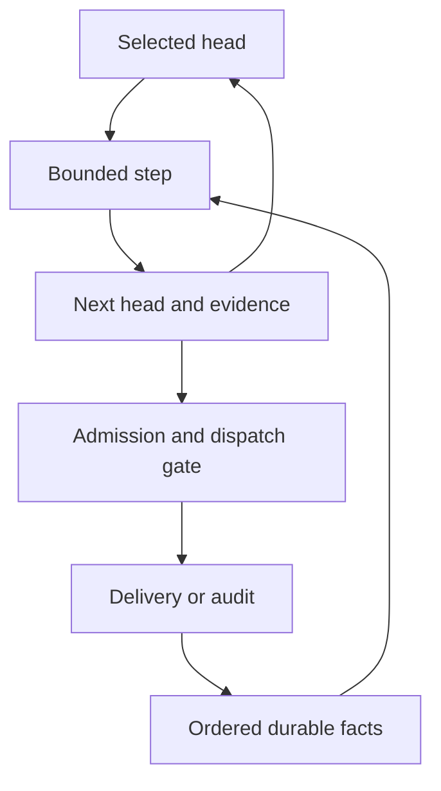

# PAREDROS — implementation specification

**Version:** 2.2 (amends 2.1 for the local first release; §0 is normative and overrides conflicting text below; §21 records the 2.1 decisions and evidence)\
**Date:** 2026-11-24 (2.1: 2026-11-15)\
**Status:** Proposed implementation contract; no implementation is claimed by this document.\
**Product:** A personal assistant that carries continuing responsibilities through conversation, interruption, changing evidence, upgrades, and improvements to its own methods.\
**Architecture decision:** A separate Zig application using Protean as a library, its existing native execution machinery, and its coherently selected Horos/Kosmos dependencies. For the first release, each responsibility is a chain of bounded Protean tasks with explicit application admission and dispatch laws.

## 0. Amendment 2.2 — the local first release

The owner removed Slack from the first release (2026-11-23). PAREDROS therefore performs **no external write**: GitHub and the model are read through bounded tasks, and every output is a local record read through the CLI. The 2.1 delivery apparatus existed to manage the uncertainty of an external write; with no external write it has no subject. This section states the resulting laws. Where text elsewhere in this document conflicts with it, this section governs.

### 0.1 Laws of local output

| # | Law |
|---|---|
| L1 | A **message** (activation, digest, or question prompt) is part of the head transition that decides it, published atomically with that head: genesis emits the activation; the render step that renders a digest emits it **and advances the told frontier to its coverage in the same head**; the step that raises a question emits its prompt. Directive dispositions are reported by the CLI and in status, not as messages. The told frontier advances only in the transition that emits the covering digest, so "told" and "a retained message covers it" are the same fact. |
| L2 | There are no delivery tasks, delivery keys, generations, issues, outcomes (rejected/indeterminate/unknown/unconfirmed), holds, releases, prompt reissues, audits, receipts, reconciliation markers, frontier audits, or duplicate-tolerance policies. The `release` directive, the `delivery` commands and `serve --recover` do not exist. |
| L3 | `paredros messages ID` is a pure projection of the obligation's selected head chain: one entry per head that carries a message, positioned by head sequence, stable once listed. A pending question's entry shows the exact `question answer` command. |
| L4 | Pause, cancel, and transfer fence new check and render dispatch as in §7.3. A render dispatched before a restrictive directive linearized may still publish its digest; no render is dispatched after. Nothing else is fenced because nothing else is prepared. |
| L5 | Rollback or snapshot restore needs no output hold: the namespace's messages roll back with it, and a second namespace producing local records duplicates no external effect. Operating one lineage in one place remains the operator's responsibility; no hold or exclusive-ownership declaration is recorded. |
| L6 | Transfer export folds a system-originated `transfer` directive into final `transferred` heads, establishes a cut, and exports a closed bundle (§14.3). Import validates and re-admits the bundle and starts each obligation in its prior mode; a pending question survives as head data and its prompt is emitted again by the import genesis. Messages before the cut stay in the source namespace (the archive boundary). |
| L7 | Read surfaces (`status`, `task show`, `messages`, `ask`) report recorded facts, never predictions of a later daemon decision. Every turn lineage ends with a reply: the original attempt, one model retry with the frozen context, then a final pure authored failure reply (§5.4). `ask` prints the lineage's reply or says it is still pending. |
| L8 | Every caller ingress uses the §6.3 order: look up the operation identity; an identical repeat returns its original disposition and a different one conflicts; only an absent operation is validated and admitted. Caller ingress cannot express a system-only directive (`transfer`). |
| L9 | Every identifier, digest, or cursor printed by one command and accepted by another has one textual form used for both. Absolute paths are used as given; relative paths are joined to the caller's working directory without collapsing `..`. |

### 0.2 Superseded 2.1 text

- §3.1 items 2 and 5, §3.2 rows for the conversation surface, activation read-back, unconfirmed digest and output route, and §3.3's Slack thread item: conversation is `paredros ask`; proposals are confirmed with `paredros proposal confirm`; there is no protected write.
- §5.4's whole-write-history delivery retry paragraph, §6.2–§6.5 Slack ingress, interaction and button identities (the CLI paths remain), §7.3's prepared-delivery fencing, §7.4 steps 5–6, §9 and §10 in full, §13's `serve --recover` and `delivery` rows, §14.3–§14.4 output holds, exclusive-handoff and rollback audit text, and Slack items in §19–§21.
- §18 acceptance rows concerning Slack ingress, external sends, audits, markers, uncertain or unconfirmed output, rollback audits and output holds (A01–A03, A16–A27, A35, A39, A42, A56, A60, A61, A64, A67, A69, A74, A75, A79, A80, A82, A86) do not apply. These rows are restated: A07 — the genesis head carries one activation message; A17/A18 — cancel fences new renders and the obligation reaches a cancelled head; A37/A50 — import preserves controls, untold evidence, method source and costs, without an output hold; A43 — the raising head carries exactly one prompt; A44 — a CLI answer closes the question and the prompt stays in the message history; A70 — a render dispatched before a pause may publish its digest, none is dispatched after; A71 — the lineage ends with an authored failure reply printed by `ask`; unknown model charges remain visible.
- Earlier owner decisions still apply: acceptance case A65 is omitted; exhausted storage surfaces as Protean's `StorageUnavailable` fence rather than a visible hold; GitHub transport health in status is omitted; namespaces, fixtures and configurations of the unreleased prototype are unsupported.

## 1. Decision and purpose

Build **PAREDROS** in a separate repository. PAREDROS owns personal assistant behavior, integrations, configuration, and presentation. Protean owns admitted computation, execution custody, capture, in-task recovery, and admission receipts. Necessary general runtime changes belong upstream in Protean. PAREDROS consumes a pinned revision containing those changes.

PAREDROS is not a renamed copy of Protean's existing snapshot investigator. That application supplies useful authored constructions and examples, but its terminal reporting, immutable input snapshot, and treatment of inbox messages do not provide the required assistant semantics. Likewise, importing NullClaw's agent loop would introduce a competing owner of execution and recovery. Borrow connector code and concrete protocol lessons selectively.

Two rules govern the implementation:

> Ordinary authored computation produces the interface. Existing owners govern its use. A small real counterexample drives a genuine repair. Everything else must justify its necessity to that path.

> In this release, idle responsibility state is typed application data. Bounded tasks acquire evidence, render, or deliver. Every transition names its predecessor and the durable facts it consumes; every external dispatch remains subject to current authority.

The second rule is a product design choice motivated by the baseline (§2.1), not a theorem that Protean cannot host long-lived tasks. Compatible tasks can resume from captured outcomes; an old executable can continue its own work. Bounded tasks make incompatible-build continuity and replacement of an unrecoverable read or model call practical without first extending controller succession, deadlines, and unknown-occurrence recovery together. The cost is an application admission protocol that PAREDROS must specify and qualify (§5). Storing that protocol in existing Task inputs and results avoids another database; it does not eliminate its correctness obligations.

The first release must complete one useful responsibility end to end: **watch a configured GitHub repository branch, notice newly observed commits, prepare an evidence-linked digest, and deliver it to the configured owner's Slack DM**. The owner can converse with PAREDROS and inspect or control the same durable work through a local CLI. Responsibilities continue across compatible restart and explicit upgrade or transfer. Observation continues during unresolved delivery when storage and source access permit it; held output, coverage gaps, and unknown charges remain visible. Recovery never invents evidence or permission to repeat a possibly completed write.

The distinguishing capability is that a responsibility can acquire and retain a better method without losing its purpose, evidence, history, or authority boundaries. In this release a method is a retained, checked computation that the authored step invokes for the replaceable part of its work (§12); everything that carries authority stays authored. Whether a particular learned method is better is an experimental result, not an assumed property of the product.

## 2. Baseline and source of truth

This specification separates inspected source facts, observed protocol behavior, and proposed contracts. It does not claim that current upstream already exposes every required seam or that the acceptance cases have been implemented.

| Component | Inspected baseline | Treatment |
|---|---|---|
| Protean | Package 9.1.0; commit `38d301846b18b4fcf8757bd66e4792a14826c013` | Starting point for bounded upstream changes |
| Zig for Protean | 0.17.1 | Initial PAREDROS toolchain |
| Kosmos | 9.2.0; commit `1bc3e2cc5d2cf1c8797315dd12a89fdeb1102f8a` | Inherit Protean's admitted selection |
| Horos | 8.0.1; commit `1f5320038f45ae00050450edbc08afbb8a97a030` | Inherit the same coherent dependency graph |
| Native persisted state | Format 22 | Baseline only; see B6 |
| NullClaw | Commit `5f1cade05c19b6ecdfb9565ae3305e892e484da9`; manifest 2026.5.29; Zig 0.16.0 | Design reference and selective MIT-licensed code reuse |
| External protocols | Slack and GitHub official documentation and live GitHub API probes, 2026-11-15 | Pin protocol choices and recheck them when implementing |

After upstream work lands, replace the starting Protean pin with one exact qualified revision. Do not independently choose newer Horos or Kosmos versions. Preserve dependency provenance and the build manifest. These facts are supported by [P1], [P2], and [N1].

Throughout this document, **must** denotes required behavior; **should** denotes a default that may change with a documented concrete reason. Proposed API and type names describe contracts, not APIs that already exist.

### 2.1 Baseline constraints that shape the design

These facts are pinned to the revisions above. Their consequences distinguish current implementation limits from choices made for PAREDROS.

| # | Inspected fact | Consequence for PAREDROS |
|---|---|---|
| B1 | A saved task binds the executable hash, profile, and resources; compatibility is checked before driving it. [P17] | Same-build recovery is supported. A different binding cannot transparently resume the continuation; preserve the old executable or move application data through an explicit compatibility/transfer path. |
| B2 | Resume refuses an unknown occurrence. Cancellation intent can be recorded but cannot retire that occurrence without settlement; messages are refused once cancellation is pending. [P18] | PAREDROS may supersede an unusable task at the application level while preserving its unresolved occurrence. Unknown does not itself mean messages are forbidden or that future valid reconciliation is impossible. |
| B3 | The current hosted-model declaration has no recovery adapter and uses `store: false`. Loss after possible transmission and before capture can remain unknown. Captured responses can be interpreted without another call. [P19], [P20], [P35] | Isolate model work in bounded tasks. Distinguish reusable capture from lost response, and known usage from unknown possible charges. |
| B4 | Durable event records have task-local sequence/revision, not a wall clock; current wait readiness has no deadline contract. [P7], [P22] | Admit the clock as input for this design. An owner deadline extension or captured clock would be another possible design, not an impossibility. |
| B5 | The shipped session selects one launch profile; handler grants bind its resources. [P21] | Handlers additionally validate the particular repository/DM against the admitted input and current configuration. Only changes that alter execution bindings strand continuations. |
| B6 | Startup validates retained closure, captures, and reconciliations against required registered identities and schemas; incompatible retained declarations can prevent opening. State-format changes require a fresh namespace at this baseline. [P25], [P30] | Retain required declaration versions, input/result decoders, and dependency codecs; otherwise transfer. A version field alone is not a decoder. |
| B7 | Checkpoint import requires an empty namespace and matching program/build contracts. [P26] | It is not a general multi-task application upgrade facility. |
| B8 | Controller succession has specified model/handoff activation cuts. Ordinary constructed computation programs cannot bind external effects; reconstructed controllers are a separate case with admitted imports. [P23] | A retained render method is the smaller v1 adaptation target. General controller succession remains deferred rather than declared unusable. |
| B9 | A recovery receipt lookup must authenticate the exact historical capture bytes of the original effect. [P24] | Slack history is new application evidence unless an admissible exact-capture mechanism is demonstrated. It does not manufacture the old HTTP response. |
| B10 | The shipped entry is a stdio session; ordinary external work shares one work slot while the owner loop continues admitting. [P14], [P31] | Expose a public embedding seam; measure head-of-line delay and acknowledgment latency. |
| B11 | Protected authoring admission checks authored source too, but no suitable general checked notification-write construction is provided. Native registry forgery is outside that source-level trust claim. [P10], [P28] | Add the smallest checked authored write and retain the trust boundary around installed native adapters. |
| B12 | No general deletion or namespace-wide backup facility was found; retained state is audited at startup. [P25], [P33] | Measure growth; use an explicit continuity bundle and rollover, with the limitations in §14. |

The Store's current task listing is ordered by task ID, not global admission order. A per-obligation directive order must be persisted in application inputs (§6.3); it cannot be inferred from a listing or timestamps. [P36]

## 3. Product scope

### 3.1 First complete release

The release includes:

1. One Linux daemon under one operating-system account, one configured human operator, and one durable namespace.
2. Ordinary text conversation through one configured Slack app-to-owner DM, button confirmations in that DM, a local CLI, and machine-readable stdio access to the same daemon.
3. One fully qualified GitHub branch monitor. The data model permits separate monitors, but qualifying multiple tenants, many channels, or high concurrency is outside the first release.
4. Fixed-interval recurring checks, a manual check, pause, resume, cancellation, amendment, status, and recovery inspection.
5. One protected write, performed only by the authored delivery task.
6. Fresh GitHub observations, durable evidence, honest completeness and freshness, and source-linked answers.
7. A working bounded adaptation experiment over a retained method, with honest negative outcomes.
8. Installation, credential configuration, restart, upgrade by compatibility check or transfer, and diagnostics sufficient for daily use.

General conversation can explain work, answer from materialized evidence, and ask the operator for missing information. It must distinguish an explanation or proposed action from a responsibility that has actually been admitted. Creating or changing a monitor passes the same typed directive whether initiated through CLI or conversation.

A model never admits an operation. It may produce a typed **proposal** bound to the authenticated initiating input, the selected target, and, where one applies, the expected specification revision. A model-interpreted proposal takes effect only when the operator confirms its authored operation description through a bound button or CLI command (§6.5). Exact typed CLI commands are already directives and need no redundant confirmation. Manual checks also require an authenticated directive: they can incur reads, inference, and notification under the existing grant.

### 3.2 Defaults chosen by this specification

These are implementation defaults, not claims that the user has already supplied deployment settings:

| Choice | Default |
|---|---|
| First external conversation surface | Slack Socket Mode; top-level owner DM text; buttons for confirmations and answers |
| First continuing source | One explicitly configured GitHub repository and full branch ref |
| First schedule | Every 15 minutes, anchored at activation; configurable positive interval |
| Initial observation | Establish a baseline; do not send historical commits as new activity |
| Activation | Send one activation notice and read it back to qualify reconciliation (§9.4) |
| Notification criterion | Drain the outstanding observations in order using bounded digests of complete batches; never silently drop owed commits (§5.2, §12.1) |
| Missed intervals | Coalesce into one catch-up check; record the skipped interval count |
| Overlap | One live step attempt per obligation |
| Unconfirmed digest | Hold output while observation continues. An explicitly admitted duplicate-tolerant policy may permit one labelled superseding issue (§9.4) |
| Conversational changes | Confirm model-interpreted proposals with a button or CLI; exact typed commands are direct instructions |
| Unusable step attempts | At most three phase attempts before deferring to the next slot; backoff starts at one minute. Recover retained captures first (§5.4) |
| Graceful stop | Wait up to 45 seconds for an in-flight effect before exiting |
| Upgrade | In place only when the namespace check passes; otherwise transfer (§14) |
| Backup | Snapshot exports on a schedule the operator chooses; a raw copy of the namespace is not a backup (§14.4) |
| Output route | The configured owner DM; immutable for an already prepared delivery |
| Model integration | Protean's existing configured hosted-model path; no new provider framework |
| First deployment target | `x86_64-linux-musl`; macOS qualification follows separately |

The deployment must supply the owner identity, Slack app/workspace/channel identifiers, secret references, repository/ref, and exact model configuration. Do not infer the owner from the first person who messages the bot.

### 3.3 Explicitly deferred

Defer public webhooks, group chat, threaded Slack conversations, multiple owners, arbitrary shell access, browser/device control, calendar or email mutations, GitHub writes, voice, a web UI, a connector marketplace, distributed deployment, model-authored controllers, and file-level change analysis. Later integrations must reuse the boundaries below. Do not build their frameworks in anticipation.

Do not claim OpenClaw feature parity. OpenClaw is a product and operational reference [O1]; NullClaw is a useful source of small native integration patterns. PAREDROS's first release is judged on a complete continuing responsibility, not connector count.

## 4. Ownership and process architecture

| Concern | Owner | Boundary |
|---|---|---|
| What the assistant is trying to accomplish | PAREDROS authored application | Typed specifications, heads, notification policy, and schedule policy |
| The state of a responsibility | Selected head, referenced evidence, and admitted facts not yet folded, all in Protean's Store | Head selection and consumption follow §5; no second cursor database |
| User-facing operation schemas and rendering | PAREDROS | CLI, Slack, and stdio invoke the same typed directives |
| Connection management and external protocol parsing | PAREDROS native adapters | Authenticate, normalize, capture, and transport; do not plan work |
| Turning durable facts into admissions | PAREDROS authored transition rules and trusted native driver (§5.5) | Driver verifies/materializes facts, serializes admission, and enforces dispatch eligibility; its index is rebuildable |
| Admitted tasks, execution, custody, capture, in-task recovery, receipts | Protean's existing native owners | One authoritative namespace and serialized publication path |
| Source checking, types, effects, captures, use discipline | Horos through Protean | Preserve the selected contracts |
| Executable state and continuations | Kosmos through Protean | No second evaluator or continuation representation |
| Credentials and host resources | Native environment | Referenced by opaque binding; never exposed as model data |
| Model context | Materialized from heads, admitted inputs, and confirmed outputs | A projection, never a competing source of truth |
| Delivery decision | The authored step; the delivery task performs it | External receipt, audit evidence, or explicit uncertainty |

The daemon hosts the existing Protean native session and connects it to Slack transport, a local control endpoint, and the driver. Transport loops may run independently so a slow model cannot block Slack acknowledgments. They submit commands to the single owner; they do not mutate the Store concurrently or execute assistant policy.

Use a local Unix-domain control socket with filesystem permissions and peer identity validation. The CLI connects to it; stdio is a framing adapter over the same command surface. Neither starts a second owner over the namespace. Offline inspection is available only when the daemon is stopped, because namespace ownership is exclusive.

Current `addNativeSystem` supplies application source and environment handlers but fixes the executable entry to the shared stdio host, whose transport is bound to standard input and output and whose worker driver is not public [P2], [P31]. Expose a public session/drive boundary and allow a custom entry module in the build helper (U1, §15). Preserve the existing stdio entry as the default. PAREDROS must use this seam rather than copy private host or worker code.

The application may persist configuration and connector bindings. It must not mirror Protean task state, create a second effect journal, or keep a schedule or cursor outside the Store. Current Store record kinds are closed: adapters do not add tables to Protean's database.

### 4.1 Protean facilities used, and deliberately not used

| Facility | Use in v1 | Reason |
|---|---|---|
| Admission with client-operation receipts | Every task | Identical repeats replay; conflicting repeats are refused. This deduplicates an identified admission; lineage, ordering, and supersession require the additional laws in §5–§6. |
| Capture before interpretation; in-task recovery from captures | Every effect | A restarted compatible task continues from what it captured. |
| Task cancellation; inbox messages | Cooperative stopping of live work | Current authority is enforced at dispatch as well; inbox polling alone is insufficient. |
| Checked model construction | Render steps and turns | Existing hosted-model path. |
| Computation programs with typed ports | Retained methods (§12) | A model-built program can compute but cannot bind an external effect. |
| Durable wait across idle time | Not required by the base design; a measured optimization may use it (§5.6) | Keep the compatible recovery and explicit supersession laws. [P7] |
| Question and answer owner | Not used | A question that waits for days is a continuation (B1). A pending question is head data; an answer is a directive. [P5] |
| Controller succession | Deferred | Retained methods are the first adaptation scope; this is not equivalent to general controller succession. [P12] |
| Occurrence reconciliation through recovery adapters | Not used | B9. Evidence about an unknown delivery is acquired by a separate audit task. |
| Checkpoint export/import | Not used for upgrade | B7. Obligations move by transfer (§14). |

## 5. Durable model: obligations, steps, and heads

### 5.1 Task kinds and materialization

Every unit is an ordinary Protean task admitted with a stable client-operation identity [P27]. A versioned `Types.Input` selects its kind. The application has no seed controller.

| Kind | Work | Terminal result |
|---|---|---|
| Genesis | Validate an operator specification or imported state; no external effect | Head 0 |
| Step | Fold admitted facts, then perform at most one check or render phase | Next head and any newly acquired immutable batch |
| Directive | Record one authenticated typed request; no external effect | Directive disposition data for folding |
| Delivery | Perform at most one protected write | Confirmed, rejected, or indeterminate outcome |
| Audit | Read bound history | Positive matches, not observed in the scanned window, or inconclusive |
| Turn | At most one model call over a frozen context | Reply intent and proposals |
| Experiment | Execute an identified finite comparison plan; simulated writes | Report with attempt lineage |

A check can make several reads of one frozen comparison. A render or turn makes at most one model call. Each completed phase is published before a different external boundary is crossed. Unknown outcomes remain attached to the original task even when the application can make progress elsewhere.

A task reads no other task's records. The driver copies named authoritative inputs, results, captures exposed through approved views, and evidence into the new input. It verifies identity, revision, and digest before copying; a reference next to unrelated bytes is not provenance. Materialization and its clock observation are frozen on first admission. Replays reuse them (§6.3).

### 5.2 The head and its transition laws

A head is a versioned terminal result of a genesis or step. It describes the selected application state and names its immutable dependencies. Admitted but not yet folded directives and settlements remain authoritative pending facts; the current head must not hide them from status or dispatch eligibility.

| Group | Required content |
|---|---|
| Identity | Obligation/genesis ID, lineage root, sequence, exact predecessor task/result digest, attempt and supersession lineage |
| Consumption | Highest contiguous directive ordinal folded; exact identities/revisions of other facts consumed in this transition; previous head links let the index reconstruct consumption |
| Specification | Revision, owner, repository identity/route/ref, destination, schedule and admitted policies |
| Mode | Active, paused, or cancelled; final transferred/cancelled disposition where applicable |
| Observation | Source epoch, monotone observation sequence, tip OID, acquisition evidence, last check with coverage/freshness, any unresolved source condition |
| Outstanding work | Bounded summary and references to the ordered, immutable observation records still owed to the operator; no lossy truncation of this backlog |
| Told frontier | Highest contiguous observation sequence confirmed as covered, its source epoch/tip where meaningful, and the establishing delivery receipt held by value |
| Delivery | Current digest intent, unresolved outcomes and holds, reconciliation capability, references to historical unresolved notices/replies |
| Question | Identity, exact condition/evidence/specification binding, allowed answers, prompt intent, or none |
| Method | Ordinary or adopted source/contract digest, applicability, bounded cache state, fault disposition |
| Schedule | Next admission, clock observation, independent provider retry constraints |
| Intents | Complete currently wanted active deliveries/audits, frozen payloads, generations, and not-before reasons |
| Accounting | Known calls/tokens/bytes, attempts and failures, and explicit possible charges whose usage was never captured |

Large evidence stays in the acquiring task's retained records. The head carries fixed-size frontier/record anchors and bounded summaries, not an ever-growing array of batch references. The index derives the outstanding ordered records from the selected head chain, not a separate queue service. Unknown notices/replies likewise remain in their authoritative delivery records, with bounded active summaries and pageable inspection; they cannot fill the head until control admission fails. If storage cannot retain another complete batch, the check stops with a visible storage hold before advancing observation. Bounded presentation must never imply bounded historical retention.

Digests consume the oldest contiguous prefix of complete outstanding batches that fits the rendering input limit. An individually oversized but completely acquired batch gets an authored digest with the verified count, comparison link, and explicitly abbreviated entries; it does not require an unbounded model input. A provider-truncated comparison is not eligible for that automatic fallback: it retains incomplete coverage until an explicit disposition. Full acquired evidence stays available locally. Source checking can continue while notification is held; accumulated records are neither overwritten nor silently skipped.

Git OIDs are identities, not ordered counters. Observation sequences are monotone across source epochs. An operator-authorized rebaseline appends an explicit gap/epoch record after earlier owed batches; it does not erase them or claim that skipped commits were acquired. Stop a digest prefix at a gap or show its verified ranges and the gap separately; never present it as one complete comparison across the rewrite. Told progress concerns this ordered record stream, including honestly labelled accepted gaps, rather than numerical or timestamp ordering of OIDs.

The authored transition and the driver's validation must establish:

1. The head extends the exact selected predecessor with sequence +1 and the admitted attempt lineage.
2. Each directive is folded once in its contiguous order; each other fact is consumed once by identity/revision. A later resolution is a new fact, not another charge for the old one.
3. Observation advances only with the declared evidence and coverage. Told progress advances only over a verified contiguous coverage prefix and an accepted delivery disposition (§9.4).
4. Unresolved writes and outstanding observations remain represented, directly or by retained references, until an explicit documented disposition. Size limits cannot erase them.
5. New output keys and payloads derive from the admitted specification and selected state. Head data is not an independent grant.
6. Accounting remains monotone for known usage; unknown possible charges remain visible until resolved. Late results of superseded attempts are accounted without becoming heads.

Receiving a previous head does not mechanically prove these laws. They are trusted authored application behavior, covered by the failure matrix.

### 5.3 The step

The input freezes its predecessor, event cut, and clock. Fold directives in their persisted ordinal order; fold other facts in a deterministic documented order. A fact arriving after this cut belongs to a later step, but a newly admitted restrictive directive already fences dispatch (§7.3).

After folding, a cancelled or transferred obligation returns a final head. A paused obligation performs no check/render phase. Otherwise choose a due/requested source check before draining another backlog prefix, unless source retry policy currently defers it; when checking is not due or is deferred, render an eligible prefix. At most one phase runs. Compute the next admission and restate all still-wanted intents. Final heads allow only the explicit read-only inspection/audit and disposition notices described in §7.3.

Backlog drain is serial: at most one unresolved digest, and at most one next prefix after its confirmation. Respect provider send pacing and an admitted minimum notification interval (default one minute for backlog catch-up). A minimum interval does not delay control admission. If checking continuously exceeds the configured observation interval, explicitly alternate one render opportunity with checks rather than starving notification forever; report that the requested check rate cannot be met. Qualify both source freshness and drain progress under sustained backlog.

A successful check publishes its batch before a later render starts. Sending is a separate delivery task. A pending question does not freeze unrelated checks or delivery of already verified older batches; it cannot authorize a new baseline or weaker coverage before an answer.

### 5.4 Attempts, recovery, and supersession

An attempt identity binds obligation, sequence, predecessor, and attempt number; a delivery uses key/generation. At most one attempt is **eligible** for new dispatch at a time. Historical superseded work may still return an already dispatched response.

Classify with the owner view and actual occurrence/capture state, not the word `blocked` alone:

| Finding | Required handling |
|---|---|
| Compatible queued/running/ordinary wait | Continue through the existing owner unless current control fences it |
| Retained captured or settled reply | Reuse an already interpreted outcome; interpret/consume a capture through its original owner when execution and projection compatibility permit. Do not issue replacement I/O merely because compatible projection is blocked [P35] |
| Definitely not sent or denied before effect | Apply the appropriate bounded retry or local rejection; retain the owner witness |
| Unknown after possible transmission | Keep the occurrence unresolved; decide application supersession or audit without pretending to cancel the effect |
| Incompatible executable/profile or unusable result | Supersede only through the durable lineage below; retained outcomes still count as evidence |

An unusable step is replaced by a fold-only attempt for the same sequence. It consumes the failure/supersession fact and pending controls, publishes a head, and schedules a later phase retry. Defaults are three phase attempts with exponential backoff starting at one minute, then retry at a later scheduled slot. A failed render does not prevent checking; a failed check does not erase acquired batches. A merely slow task is not declared unusable just to start another copy. An intentional cancellation for pause/cancel does not increment a phase failure streak.

A known capture schema does not make an incompatible continuation resumable. Preserve that capture and its original bindings, reuse already interpreted facts where available, and otherwise use the original compatible build or retain it as unresolved evidence during supersession. U1 does not implicitly promise a new cross-build execution or historical-projection engine.

**Supersession is an admission fact, not a claim that cancellation prevents every late completion.** Under the single serialized admission path, a replacement input names the exact superseded task, predecessor, attempt number, cancellation receipt, and event cut. Before admitting it, verify that the predecessor and eligible attempt are still current. Its committed admission makes the old attempt ineligible. A late old result remains historical; it cannot become a head or authorize another intent. Select the unique valid, unsuperseded completed attempt extending the selected predecessor. Fence conflicting successor branches or multiple eligible heads, not ordinary late historical completions. [P37]

For delivery retry, inspect the **entire protected-write history of that task**, not only its current occurrence. A null/ready current occurrence does not prove the earlier write was never sent. U1/U2 must expose a scoped witness: no write dispatch admitted; all admitted write attempts proven not-sent/pre-effect rejected; a successful retained outcome; or at least one possibly transmitted write. Only the first two permit another generation. A captured success is reused; possible transmission leads to audit/hold. This includes a crash after consuming the write reply but before publishing the terminal task result.

Audits can retry read-only attempts within their declared bound and then report inconclusive. A failed turn receives one additional model attempt using its frozen original context; if that also fails, a final pure attempt creates an authored failure reply. Turn/digest delivery still follows ordinary uncertainty rules; admitting a reply does not guarantee the user receives it.

Unknown model calls can have unobserved provider charges. Report native known counters plus the identities/count of those uncertain calls; never describe absent token data as zero usage. A later captured/settled usage fact is folded once.

### 5.5 The driver and its trust boundary

The driver is a trusted single-writer adapter for the authored application admission rules. It owns materialization, ordering, head selection, supersession, and dispatch eligibility. It chooses no prose and invents no notification policy. Its index is reconstructible from immutable admissions and retained results; it is not a second durable workflow store.

1. Rebuild the index of operations, selected head chains, directive ordinals, consumed facts, attempts, unresolved writes, and evidence references.
2. Resolve an operation identity before materialization. Reuse an existing admitted input; otherwise freeze the input once and submit under the serialized owner (§6.3).
3. Admit a fold/phase step when the selected head is due or new facts exist and no eligible step is live. Bind the exact predecessor and cut.
4. Derive only the current authorized intents. Withdraw undispatched intents that no longer exist. A pending pause/cancel/transfer and recovery hold blocks relevant dispatch even before folding.
5. Recover retained captures first; supersede unusable attempts using §5.4. Forward cooperative pause/cancel signals without relying on them as dispatch fences.
6. Sleep using monotonic time until the next relevant instant. A wake only triggers re-evaluation.

Control admission and each external dispatch decision share the serialized native owner. The driver supplies current eligibility derived from durable facts; the owner validates it immediately before committing dispatch and starting I/O. This is U4 (§15), including startup restoration before driving tasks. A queued approval, stale head, or earlier empty inbox is insufficient.

Every code path that admits work must use this protocol. An unexpected receipt conflict, missing predecessor, bad copied digest, skipped directive ordinal, or branched supersession is a visible invariant failure, not an excuse to select whichever task was listed last.

### 5.6 Cost and bounded optimization

Measure owner time, Store rows/bytes per empty check/directive, index rebuild, and startup at 10⁴ and 10⁵ terminal tasks. Initial targets, not measured facts: an empty check adds at most 64 KiB and 250 ms of owner time; startup with 10⁴ tasks completes within 10 seconds. Record the actual platform and distribution, including tails.

If a target fails, identify the measured cause before changing architecture. A bounded epoch of empty checks using existing waits and admitted ticks is one possible optimization, not the only permitted answer. Such an epoch must preserve freshness, usage, directive ordering, evidence, and supersession across interruption; unchanged Git cursors do not mean it has no progress to lose. Keep the simpler per-check task unless a witness justifies the change.

## 6. Identity, authority, and input admission

### 6.1 Keep these identities separate

| Identity | Purpose |
|---|---|
| Principal | The Protean principal: the daemon's operating-system account, one tenant. Every task is admitted under it [P4]. |
| Origin | Who initiated an input: the configured Slack operator in the bound DM, or a permitted local user on the control socket. Recorded in the admitted input. |
| Conversation | Where dialogue belongs: transport account, workspace, channel |
| Obligation | The durable responsibility; its ID is the genesis task ID |
| Step and attempt | One bounded advance of an obligation, and one try at it |
| Native effect occurrence | One Protean-owned effect request within a task, with its own dispatch and capture |
| Source observation and batch | Which external resource state was actually acquired and covered |
| Delivery key and generation | One logical output to one bound destination, and one try at it |

A conversation is not a task, a source ID is not authority, and a content hash is not permission. The same owner may converse about several obligations. Reconnects must not create new obligations.

An ordinary conversational DM or `ask` creates one bounded turn task. Its input carries the conversation binding, the admitted input identity, and a materialized context (§11). Model interpretation of that text never changes an obligation by itself; an optional exact authored command grammar is a distinct typed admission path (§6.5).

### 6.2 Ingress paths

| Input | Admission path and meaning |
|---|---|
| Operator text | A turn task; verified origin, conversation, event identity, and text |
| Operator command, button, or confirmed proposal | A directive task, or a genesis task for a new obligation |
| GitHub observation | A typed capture-backed read inside a check step; immutable source evidence with coverage metadata |
| Time | A clock observation materialized into a step's input by the driver (§7.1) |
| Outcome of a derived task | A settlement event materialized into the next step's input |

Time is not a message and repository text is not an instruction. `Types.Message` has one use in the base design: forwarding a pause to a live step. At the baseline the example application and the reconstructed controller context both treat every admitted message as a user amendment [P3]; PAREDROS's authored application recognizes its one message kind by a trusted tag and never uses a reconstructed controller context. Repository text, commit messages, and fetched documents remain evidence even if they contain commands addressed to the assistant.

The native process's local UID does not authenticate a Slack sender. The bridge must verify the configured app, workspace, operator, and channel before recording a Slack origin. Fields such as `sender`, `role`, or `origin=human` inside an untrusted payload cannot supply that authority.

### 6.3 Idempotent admission

Use existing client-operation receipts and conflict detection [P4]. A repeated operation with identical admitted bytes returns the original disposition. Reusing an identity with different bytes is a conflict, not an update. Stable external request fields and materialized context are distinct. First look up the operation identity under the authenticated principal/origin; verify its stable request digest, target, and operation kind. If it exists, return that task and reuse its frozen context, clock, predecessor, and event cut. If absent, materialize and admit once through the serialized path. A restart after admission but before acknowledgment therefore does not rebuild the input from newer heads. A mismatch is a real conflict; do not turn arbitrary `OperationConflict` into success.

| Admission | Operation identity |
|---|---|
| Turn from Slack text | The namespaced Events API `event_id` |
| Slack interaction, including a refused click | Canonical authenticated app/team/user/channel/message/action identity, value and `action_ts`, or its retained digest; never `envelope_id` |
| Turn or command from CLI | A caller-generated operation ID retained through retries |
| Genesis | Caller operation/proposal ID; imports additionally enforce one lineage per target namespace (§14.3) |
| Directive | Its stable request identity: the caller's operation ID, the proposal ID, or the question identity with the chosen answer |
| Step | The obligation ID, sequence, and attempt |
| Delivery | The delivery key and generation |
| Audit | The delivery key and ordinal |
| Later turn attempt | The original input identity and attempt |

Directives carry a per-obligation ordinal and predecessor directive identity in their immutable input. The single admission path looks up retries first, allocates the next ordinal from admitted records, and submits before allowing another allocation. A crash before submit consumes no ordinal; a crash after submit rediscovers it. Fold the contiguous chain in that order, including a request whose pure task has not yet returned. Listing order and wall-clock timestamps are not substitutes. U1 exposes the lookup and admitted inputs needed to reconstruct this chain. A directive that depends on the specification the operator saw — amend, adopt a method, revert a method — carries the specification revision it expects; folding rejects it as stale if the revision has moved, and only those directives advance the revision. Pause, resume, cancel, check, audit, and release are valid against any revision. An answer is bound to its question identity instead.

Persist the turn or directive before acknowledging its event externally. Do not acknowledge an event merely because it entered an in-memory queue. Integer counters are checked for overflow and encoded losslessly on JSON boundaries.

### 6.4 Bindings, grants, and revocation

Protean's grants are per effect role and per launch profile (B5). The first grants are: read GitHub, read Slack history, use the configured model, and write to Slack. Authority over a *particular* resource is enforced by PAREDROS:

1. Every obligation's specification names its repository identity, ref, and destination. Every effect request carries the binding from its task's admitted input.
2. Immediately before dispatch, the owner checks obligation/attempt/control eligibility (§5.5). Pause, restore hold, and supersession are eligibility restrictions, not permanent provider/binding errors. Separately, a handler validates the request binding against current configuration. An actually invalid binding produces a typed permanent local rejection; do not disguise it as a transport-level "not sent" that parks the task [P34].
3. No value derived from model output or source text can supply a binding.

A standing write grant avoids an approval prompt for each digest. It does not authorize a different channel, a GitHub write, or arbitrary network access.

Removing a binding from configuration stops future use; it does not erase evidence of an effect that may already have happened. Changing the bound repository, credential account, operator, or destination requires a freshly admitted replacement obligation. Schedule, wording, presentation, and policy amendments within the admitted bindings are directives, and so is an update of the repository's route when its identity is unchanged. Prepared deliveries keep their original binding and are never retargeted.

A configuration change that changes the launch profile or resources makes older continuations incompatible. Reuse retained outcomes and supersede only as §5.4 permits. Compatible credential refresh under the same admitted account is distinct; no binding change erases an unresolved effect or retargets a prepared output.

### 6.5 Directives, proposals, and confirmations

Directive bodies in v1: pause, resume, cancel, check, amend, answer a question, release a held digest, request an audit, request a frontier audit, adopt or revert a method, and mark for transfer.

A turn may return typed proposals. Each proposal names an operation, its target, and, where §6.3 requires one, the expected specification revision. Authored code renders the exact operation, target, changed fields, and expected revision, and binds that description and payload digest to a confirm button. The model does not author the authoritative confirmation label. A button click arrives on the same Socket Mode connection as an interaction payload carrying the user, channel, message timestamp, and value [S6]. The bridge verifies the configured app/workspace/user/channel, exact emitted proposal or question intent, action identifier/value, operation digest, and prompt issue. It binds the message timestamp to a known delivery or verifies the app-origin interaction against that exact prepared payload when its response was lost. Existence of some proposal and some app message is insufficient. A click is accepted even when the reply's own delivery outcome is unknown, because the interaction is itself evidence that the message arrived. `paredros proposal confirm ID` is the CLI equivalent.

A pending question is answered the same way: its prompt carries one button per allowed answer, and a click admits an answer directive naming the question identity. Unstructured free text never answers a question or confirms a proposal. An optional exact authored command grammar may admit explicit controls directly, with the same typed validation as the CLI; it must not use model interpretation to select that path. An unbound "yes" is ordinary conversation.

Semantic validation happens when a step folds a directive. The head records its disposition as applied or rejected with a reason. A delayed answer to a replaced question and an amendment against a moved revision are rejected there. For a directive that originated in Slack, the folding step emits a short notice of the disposition to the DM; a CLI-originated directive is reported to the CLI.

No directive is admitted for an obligation whose latest head is final; the CLI says so directly. The one request still honored is an audit (§7.3). A click that cannot become a directive — its proposal is unknown, or its obligation has ended — becomes a pure refusal turn under the stable interaction identity. Redelivery reuses it. Its reply is an ordinary delivery intent and can itself be unconfirmed; local status retains the refusal regardless.

## 7. Time, scheduling, pause, cancellation, and startup

### 7.1 Time enters as data

Protean's durable model has no clock (B4), and authored computation never reads one.

- The driver reads the wall clock when it admits a step and materializes the UTC instant into the step's input. That instant is the step's only "now".
- Record the provider `Date` header when supplied, local request/capture time, and their provenance separately. Missing or implausible provider time is reported rather than fabricated. Slack message timestamps remain lossless strings; freshness has an explicit clock basis.
- The driver sleeps on monotonic time. A timer firing is a hint to re-evaluate, never a fact.
- Local time is presentation only.

### 7.2 Schedule semantics

Store UTC instants and an interval anchor. The first release supports elapsed fixed intervals, not civil-time cron expressions. The authored step computes the next admission: the first anchor-aligned slot after its clock observation. Slots that passed while a step was live or the daemon was down are coalesced into one check, and the skipped count is recorded.

A step's identity is its sequence number, not a time. A clock fault can cause early or late checks. Repeated timer evaluation alone does not create a second output identity; §5–§6 still govern admission. No local clock rule guarantees globally exactly-once delivery.

If the wall clock is earlier than the latest head's clock instant by more than a tolerance (default five minutes), the driver admits one step with a clock-regression event. That step recomputes schedule-derived instants from the corrected clock. Provider rate-limit deadlines are separate constraints: preserve a remaining duration using monotonic time within a process, and use captured server time/Retry-After or a conservative delay after restart. Do not shorten a provider backoff because the wall clock regressed. Subject to source/provider availability, scheduling resumes within one interval; repeated clock faults are reported rather than covered by an unconditional latency promise.

A manual check is a directive. If no step is live it is folded at once. If one is live, exactly one follow-up step performs the check, and further requests coalesce into it. It does not change the anchor.

### 7.3 Pause and cancellation are distinct

The linearization point for a restrictive directive is its durable admission under the native owner. An external dispatch committed earlier may complete; one committed later must satisfy the new restriction. Admission and the pre-dispatch eligibility decision must be serialized, including work already computed by a guest. Polling an inbox before an effect leaves a race and is only a cooperative optimization.

`pause` immediately fences new check/render dispatch and ordinary output for that obligation, including already prepared tasks. It does not depend on the live step processing a message. Captured responses and already transmitted work are recorded truthfully; fold-only steps continue so the head catches up. Explicit read-only audits and control disposition notices remain allowed. New model turns about the paused obligation may explain its state but cannot reactivate its work.

If a fenced step cannot end from already acquired data without another prohibited effect, request its cancellation and admit a fold-only replacement through §5.4. Its committed replacement admission removes the old step's eligibility. Preserve acquired evidence and possible charges; this control-driven replacement does not count as a phase failure. A pending delivery can stay fenced or be withdrawn with its transmission witness intact; a temporary pause must not turn it into a permanent binding rejection.

`resume` is an admitted directive returning the obligation to active after folding. It is not authorization to repeat an unknown write. A withdrawn delivery may acquire another generation only with the task-wide non-transmission proof in §5.4. Held digests remain held until their documented policy/owner disposition resolves the hold.

`cancel` fences the same work, requests cooperative task cancellation, and is folded into a final head. An unknown task need not become natively cancelled for the application to end its responsibility. A late response/result is retained and shown but cannot revive the final obligation. Directly requested audits and the final control notice remain available; final status includes later settlements without pretending the immutable head changed.

An audit does not lift a pause or authorize a write. Pending controls, effective dispatch mode, and folded mode must all be visible when they differ.

### 7.4 Startup policy

Opening a namespace does not itself resume tasks [P8]. Startup must establish eligibility before any worker dispatch:

1. Check namespace/build compatibility and acquire exclusive ownership. Refuse incompatible state without mutation (§14.2).
2. Resolve credentials and bindings; rebuild operation lookup, directive chains, selected heads, supersession, outcome history, and lineage holds.
3. Install current control, revocation, supersession, and recovery fences in the serialized owner. Do not first resume every task and then inspect prepared writes.
4. Resume compatible work from retained captures/replies. Diagnose blockers; supersede genuinely unusable attempts under §5.4. Recovering a captured response is not a new external dispatch.
5. For an ordinary restart with an authoritative, non-rolled-back namespace, a still-authorized delivery with a task-wide proof of no transmission may dispatch. Positive history evidence can additionally suppress a send, but a negative or timed-out lookup is never non-transmission proof.
6. On import or known rollback (`--recover`), treat pre-cut prepared/unresolved writes as possibly sent in a lost future. Run audits while writes remain fenced. Positive verified evidence can settle them; lack of a marker preserves uncertainty (§9.4, §14.4).
7. Connect transports and evaluate eligible admissions. Reads and controls may become available while output recovery holds remain.

Ordinary restart assumes the Store has not been externally rolled back. That assumption is operational, not discoverable from the stale Store itself. No startup scan establishes exactly-once behavior across arbitrary rollback, deletion, or duplicated installations.

### 7.5 Stopping

On a stop request: cease new admissions, let an in-flight effect finish within the configured grace, park, and exit. Loss after possible transmission and before capture may leave an unknown outcome (B3). If the grace expires, classify captures and unusable attempts as for a crash. The process exit status reflects whether the stop was clean, not whether historical unknown attempts exist.

## 8. GitHub branch monitor

### 8.1 Coverage contract

The monitor observes branch heads and the complete commit set between two successfully sampled heads when the new head descends from the previous checkpoint. It does not promise every transient branch state, every push event, or a complete file diff. A branch can move several times between polls; only acquired states are evidence.

A digest has a **trusted frame** and an **untrusted body**. The frame is built by authored code from acquired evidence: repository and ref, base and tip OIDs, observation time, commit count, a bounded list of commits, and links. Every link in a digest is constructed by the application from verified OIDs and the bound repository; no link comes from a model or from commit text. The body is method output and is rendered inert (§9.2). Unsupported claims about code behavior must be omitted or labelled as inference. File-level analysis is deferred.

Do not use the repository Events API as a change log. The provider documents a 300-event, 30-day window and latency of up to six hours [G4].

### 8.2 Acquisition algorithm

1. Read the repository resource for the configured route and require its numeric `id` to equal the bound repository identity. Retain owner/name only as the current route and display name. Neither the reference response nor the comparison response carries the repository identity, and name redirects stop working once another repository takes the old name [G6]; perform this check before acquisition and again before accepting its result. These observations detect ordinary rename/reuse races; the name-routed API does not provide an atomic repository-identity transaction or eliminate an adversarial ABA change.
2. Read the exact Git reference. Configuration stores `refs/heads/X`; the endpoint takes `heads/X`. Encode each path segment and keep `/` literal. Do not use prefix-matching refs. Validate the returned full ref, a commit object type, and a 40-hex OID; a repository using another object format is unsupported and reported. Capture the head OID and response evidence.
3. On first activation, durably establish that OID as both cursors. Historical catch-up is a separate explicit operation.
4. For a later check, freeze `A` = observed tip and `B` = acquired head. If equal, record a successful empty observation with no model call and no notification.
5. Query the comparison `A...B` with full OIDs, `per_page=100`, and the pinned API version. Follow `Link` pagination to the end while keeping the same frozen comparison, API host, and credentials. Accept a provider-returned `/repositories/ID/compare/...` route only when ID equals the bound repository; the provider may use that route instead of owner/name. Reject cross-host or mismatched-resource links.
6. Require all of: status `ahead`; `base_commit.sha` and `merge_base_commit.sha` equal to `A`; `behind_by` zero; `ahead_by` equal to `total_commits` equal to the number of unique commits acquired; identical top-level metadata on every page; `B` included and `A` excluded; no repeated commit. Anything else is incomplete. Commit timestamps and list position are not a correctness cursor.
7. Recheck repository identity; discard the candidate batch on a detected binding change. Publish a complete immutable observation record and a head referencing it. Only that selected head advances observation. This is sampled API evidence, not an independent traversal/proof of the entire Git object graph.

**Observed comparison coverage mismatch.** An independently repeated read of `torvalds/linux` v6.6...v6.7 returned provider-reported `ahead_by=18404` and `total_commits=10000`. With frozen OIDs and `per_page=100`, page 100 contained 100 commits including the requested tip and no next link; page 101 was empty. Checking only acquired count against `total_commits` can therefore accept truncated coverage. Keep the additional consistency guard. This probe does not establish that `ahead_by` is universally exact, nor that 10,000 is a stable API contract. Treat the mismatch as incomplete comparison coverage, with an observed provider limit as the diagnosed instance. Evidence and hashes are in §21.2.

Use GitHub REST API version `2026-03-10`; record it with request identity [G3]. Without paging parameters the commit list is capped at 250; the file list is capped at 300 for the whole comparison and appears only on the first page. Complete commit monitoring must paginate and must not claim file coverage. The repository, reference, and comparison endpoints require only read access to repository contents and metadata [G1], [G2], [G7].

Batch identity includes the prior batch sequence and source binding as well as `A` and `B`. A branch that legitimately revisits a prior pair of heads is not a duplicate.

### 8.3 Rewrites, failures, and freshness

A divergence/rewind or comparison coverage mismatch raises a question bound to the exact repository/ref, source epoch, base/tip, condition digest, and specification revision. Allowed answers may establish a new baseline with an explicit gap, or accept a provider-reported count-only record and comparison link. Neither answer creates complete commit evidence. Preserve older outstanding batches and record the coverage change permanently.

Checks continue. If the condition materially changes, replace the question with a new identity; an answer to A→B cannot authorize a baseline at C. Close a question whose condition clears. A gap or count-only acceptance is a deliberate weaker coverage disposition, not a successful complete scan.

Every other failure is an incomplete check that keeps polling: a `404` on the reference or a commit, a repository identity mismatch, a permission failure, a rate limit, a timeout, or a malformed body. Keep the observed cursor and show its age. A `404` means unavailable under this request; it does not prove deletion. On an identity mismatch nothing further is read from that route. When one condition persists across several consecutive checks (default four), announce it once in a notice. A different repository requires a new obligation; a renamed one needs only its route amended.

Conditional requests and ETags are keyed by exact request identity, API version, and credential binding. A `304` revalidates that request's retained response; it does not establish freshness for other pages or resources. A `304` counts against no primary rate limit only when correctly authorized [G5].

Honor provider rate-limit and retry headers as a not-before instant on the next admission. "No changes" requires a successful sufficient observation, not the absence of a new response.

Only follow pagination or redirect targets consistent with the bound service and repository. Never forward credentials to URLs found in commit text or unexpected redirects.

### 8.4 An interrupted read

A read whose response was lost leaves its occurrence unknown, and Protean never substitutes a later response for it [P15]. If there is no usable capture and the attempt is unusable, it is superseded under §5.4 and a later step observes afresh. Compatible captured pages remain recoverable within their original task; interruption alone does not require discarding them. That step reads the current head again and acquires its own comparison. The dead attempt, its partial evidence, and its cost remain recorded. No cursor moves until a complete batch is in a head.

## 9. Slack conversation and notification

### 9.1 Ingress

Use Socket Mode. It avoids a public HTTP listener. Keep the app-level connection token separate from the bot token. The installation needs the app connection scope, the bot's DM history and message-writing scopes, the Messages tab enabled, and interactivity enabled; validate the exact manifest during implementation [S1], [S2]. The app must be an internal, undistributed app: the 2025 history rate limits apply to commercially distributed apps and would make audits impractical [S7].

Bind the configured app ID, workspace ID, operator user ID, and DM channel. Accept top-level ordinary text and button interactions from that operator in that channel. Acknowledge and ignore, with a diagnostic disposition, the app's own messages, other users, other channels, edits and deletions (including edits generated by the provider), files, threads, unsupported subtypes, and malformed or oversized input. They must not acquire operator authority or start model work.

Acknowledge each envelope by its `envelope_id` only after durable admission or after an ignore disposition is established. The acknowledgment path is authentication, classification, and admission only; it must not wait for a model, a scan, or a delivery. Slack's official Socket Mode SDK guide specifies acknowledgment within three seconds; use that as the hard budget and one second as the target [S8]. A failure to persist within that budget must be reported; never acknowledge a supported instruction merely to conceal admission failure.

Slack does not document a retry schedule for unacknowledged Socket Mode envelopes, delivers events to any one of an app's open connections, and by default drops events more than two hours late [S1]. Therefore:

- Do not rely on redelivery for correctness. If a redelivery arrives, the stable event or interaction receipt returns the original disposition and frozen input.
- An event lost during downtime is lost. Status shows the last admitted event time. Recovery may inspect history to report a gap; it must not turn historical messages into fresh instructions.
- Use a dedicated app/installation for PAREDROS and exclude unrelated consumers across all of that app's connection tokens. Slack distributes events across an app's connections; a dedicated token alone does not isolate the stream. Namespace locking cannot enforce exclusivity across separate installations.

Reconnects and refreshed WebSocket URLs are ordinary transport events.

### 9.2 Output intent and rendering

Every outbound reply, prompt, notice, and digest is a delivery task derived from an intent. Local CLI output needs no Slack effect. No adapter may send by any other path.

An intent freezes the destination, the rendered payload, its purpose, and its key before any dispatch, and names the generation wanted (§5.2).

| Output | Delivery key |
|---|---|
| Digest | Lineage/obligation, prior told frontier, selected complete coverage prefix, and issue ordinal; a superseding issue explicitly names its predecessor |
| Activation notice | Obligation |
| Question prompt | Obligation, question identity, and issue ordinal |
| Directive notice | Obligation and the directive's request identity |
| Reply | The turn task |

Within one key and generation, identical content returns the existing task and different content conflicts (§6.3). A **generation** is another try at the same output after a provable non-dispatch or a retryable rejection. An **issue** is a new output for the same purpose (§9.4). A digest covers an explicit contiguous prefix after the told frontier, possibly one of several pending batches. Its exact coverage, source epochs, predecessor, and evidence digests are frozen; later checks cannot extend its confirmation beyond that endpoint. A superseding issue covers at least the unresolved issue's prefix; it need not absorb an unbounded backlog. If a smaller input limit after upgrade cannot accommodate that prefix, use an authored abbreviated replacement preserving its exact coverage rather than silently shrinking it.

Rendering rules:

- Use plain-text fields for untrusted model/source text. For top-level text set `parse=none` and `mrkdwn=false`; use Block Kit `plain_text` for untrusted blocks, with the appropriate field encoding. Disable link/media unfurls and automatic mention/URL parsing. Authored verified links occupy separate trusted fields. Test bare URLs and mention syntax; escaping `&`, `<`, `>` alone is insufficient [S4].
- Keep the authored top-level text within 4,000 characters and validate every block/field against its own documented limit [S4]. Never rely on provider truncation/splitting. Abbreviate entries deterministically with an explicit count/coverage statement; full acquired evidence stays available locally.
- Attach metadata with event type `paredros_delivery` and a flat payload: marker schema, delivery key digest, generation/issue, content SHA-256, lineage root, obligation, source epoch, kind, prior and covered observation sequences, evidence-manifest digest, and base/tip OIDs where applicable. The lineage root is the first obligation ID of a chain of transfers, so a later namespace can recognize its own markers. Do not put source text, secrets, or grants in metadata; Slack documents metadata as accessible to any app or user who is a member of the workspace [S3].
- Compute the content digest over the canonical rendered content and controls **before adding reconciliation metadata**, excluding the metadata containing that digest. This avoids a self-referential hash. Slack rewrites message text; text read back is evidence and is never compared byte for byte.

A positive response with channel and timestamp confirms a send even if the provider warns about or drops the metadata; record degraded reconciliation capability and never resend a confirmed message to repair its marker. A truncation warning is a rendering fault.

The return route is the obligation's or conversation's binding. A model cannot replace it with a channel found in source text. In-flight output does not migrate when configuration changes.

### 9.3 Honest delivery states

| State | Meaning | Allowed next action |
|---|---|---|
| Prepared | An immutable intent is in a head; no dispatch has been admitted | Dispatch after current binding, pause, and cancellation checks |
| Dispatching | The request may be reaching the service | Await capture |
| Confirmed | A provider response or an audit identifies the accepted message | Record channel, timestamp, and marker; move the told cursor if §9.4 allows |
| Rejected, retryable | The provider reported an error it raises before any effect, and the cause may pass | The next step wants the next generation, not before the provider's retry instant |
| Rejected, permanent | Such an error whose cause needs the operator, or a local binding refusal | Hold with a visible reason |
| Unknown | The request may have been transmitted and no usable outcome exists: the task is dead and may have transmitted, or it ended indeterminate | Audit (§9.4) |
| Unconfirmed | No matching visible message was observed during a completed bounded audit | Hold by default; a separately admitted duplicate-tolerant policy may permit a new issue; the original stays unknown |

A successful HTTP exchange is not a successful delivery. Parse the provider's structured result. Treat as a rejection only an error the provider raises before any effect: authentication, authorization, addressing, validation, and rate limiting. Every other `ok:false`, every server-error status, and every malformed body is **indeterminate**; Slack's own error list says `fatal_error` and `internal_error` may follow a partial success [S4]. Keep the classification as a reviewed allowlist in which an unlisted error is indeterminate. A `client_msg_id` duplicate error is not an exactly-once guarantee.

The handler's interpretation must be total: every body maps to a typed outcome, so malformed provider data becomes an explicit application outcome. An interpretation failure retains the capture and blocks; compatible interpretation may be retried without another send [P9], [P35].

Without an admissible historical-capture recovery mechanism, a delivery task that lost its response stays unknown in Protean; this design does not add such a mechanism. The obligation's ledger records what later evidence established. Neither rewrites the other.

### 9.4 Audit, uncertainty, and the told frontier

An audit reads only the bound DM with `include_all_metadata=true`. With `oldest=canary.ts`, set `inclusive=true` so the canary itself is eligible. Follow `response_metadata.next_cursor` until exhaustion; `has_more=false` or a short page does not by itself end cursor pagination. Retain request boundaries, page/cursor progress, provider times, and any incompleteness. A recent confirmed message whose marker is read back is a useful canary, not a proof of linearizable history or bounded visibility delay. [S5], [S9]

The default automatic audit occurs once after an unknown obligation delivery has been folded and a quiescence delay (two minutes by default) has elapsed. That delay is a product choice, not a provider guarantee. Further audits may be requested. Windows start at the retained canary when available; use an explicit bounded upper observation window or document a moving window and stop as inconclusive when its budget expires. Do not use a local timestamp as if it were a Slack message ID.

| Finding | Required evidence | Consequence |
|---|---|---|
| Present | Exactly one app-origin message in the bound app/team/DM with the expected marker version, key, generation/issue, lineage, coverage and content digest | Confirm this identified output by audit; validate its frontier transition separately |
| Not observed in window | Cursor traversal completed for the recorded window, canary/metadata checks passed, and no matching visible message was found | Delivery remains unknown; mark the negative observation and hold or apply an admitted duplicate-tolerant policy |
| Inconclusive | Missing/ambiguous marker, conflicting matches, missing canary where absence qualification requires it, unmarked app message, denied/limited history, malformed cursor chain, or budget exhaustion | Hold; expose the reason; permit later read-only audit |

A positive exact match may be useful without a canary. Absence cannot prove non-send: a message may be delayed, deleted, hidden by retention/access, or stripped of metadata. Never match prose or accept another app's marker, pasted JSON, or a user assertion as a provider receipt.

**Frontier recovery is causal, not chronological.** A frontier audit verifies a contiguous coverage chain against retained admitted intents/manifests, the lineage, bound repository/ref/source epochs, and the prior told frontier. Choose the maximal consistent coverage frontier; the largest Slack timestamp is not necessarily the latest coverage. A delayed superseded message must not roll back a later confirmed frontier. Forks, missing links, unbound markers, or coverage beyond available evidence remain recovery candidates requiring a hold and an explicit owner disposition. Marker numbers alone are not enough.

Do not manufacture locally acquired evidence from a Slack marker. Preserve an observed frontier already ahead of the recovered told frontier and trim only the verified covered prefix. If a stale backup lacks the evidence/intent needed to verify a later marker, retain the external delivery evidence separately and expose the gap; reacquire source evidence where possible or ask the owner to accept a specified gap. Never set both cursors to an arbitrary message tip.

For an **unconfirmed** output:

- **Default:** hold that output; keep source observation and local controls working.
- **Optional digest policy:** an explicitly admitted standing policy or an exact owner release may authorize one new, labelled superseding issue. It names the uncertain prior issue, covers at least its outstanding prefix, and says the earlier digest may also have arrived. A negative audit is only supporting evidence, not the authorization. After another unresolved/negative issue, hold. A late confirmation of the superseded issue is retained and moves no already advanced frontier.
- **Question prompt:** the same explicit duplicate-tolerance choice may allow one labelled reissue. The question can always be answered through the CLI. Reissuing a prompt never answers it.
- **Notices/replies:** no automatic reissue. Preserve their unconfirmed disposition locally.

An owner release states the exact policy decision, affected issue/coverage, and acceptance of possible duplicate delivery; a generic resume is insufficient. No generation of the original possibly sent output is retried. This is an explicit choice to issue a new digest despite uncertainty, not exactly-once delivery.

The activation notice is read back to qualify marker retrieval. Failure marks reconciliation degraded, without resending a confirmed notice. Unknown sends remain held by default even when marker retrieval is qualified. Do not send another uncertain Slack notice merely to report uncertainty in the same path.

### 9.5 Questions and confirmations

A question is data in a head: its identity, the exact condition/evidence/revision that raised it, the allowed answers, and its emitted prompt binding. The prompt is a delivery derived from that head like any other. Nothing parks while a question is pending, so a question survives restarts, rebuilds, and transfers. Checks continue meanwhile; if a later check finds the condition gone, the step closes the question and says so in a notice.

An answer is a directive bound to the question identity (§6.5). It may arrive through the CLI before the prompt is confirmed. The next step folds it and closes the question; the prompt's intent leaves the set, so a prompt not yet dispatched is cancelled while one already transmitted is settled truthfully. A prompt's delivery outcome never substitutes for an answer.

## 10. The protected write

Notification is the only external write in v1. It is performed by the delivery task and by nothing else. The checked construction that performs it (U2) must establish:

1. The request's typed payload, immutable destination, and delivery key come from the task's admitted input. No value derived from model output can reach the destination.
2. The effect is classified with the write role, and its perform site is registered by the construction. An unregistered perform, a non-write classification of the same effect, or a perform reachable from speculation is rejected at admission.
3. A delivery task performs the write at most once; replay consumes retained capture. Its whole write history supplies the retry witness in §5.4.
4. Typed capture and total interpretation through existing owners, with current dispatch eligibility checked by U4 immediately before I/O.

At the baseline a protected role requires a checked owner; the needed notification construction is absent. Authored source is also checked at protected admission; native registry/adapter code remains trusted [P10], [P28]. Implement the smallest checked construction demonstrated by the downstream delivery task. Do not solve this with an unrestricted `tool(name, JSON)` capability or by relabelling a write as a read. Model-built programs already cannot bind an external effect (B8); qualification must keep rejecting any attempt.

A stable operation receipt plus a one-write task prevents duplicate dispatch caused by repeating that same admitted task identity within an authoritative namespace. It does not prove that a newly chosen generation/issue is safe, that its predecessor is current, or that another namespace has not sent it. The application lineage, task-wide write witness, dispatch fence, and explicit uncertainty policy provide those remaining boundaries. The first release therefore does not require the general leaf-level logical receipt index proposed in 1.0; if the downstream witness disproves this narrower construction, revisit it with that counterexample.

Model-authored methods remain Horos source admitted and executed through Protean. Deployed PAREDROS does not run model-generated native Zig, shell commands, or a compiler toolchain. Trusted native adapters are part of the installed application; they are not sandboxed merely because guest computation is checked.

Copies of an old namespace can replay effects; request hashes do not imply globally unique occurrences [P16]. §7.4 and §14.4 say what PAREDROS does when a namespace is older than its own past.

## 11. Conversation and context

A turn is one bounded task: one model call over a materialized context, returning a reply and at most three proposals. There is no long-lived conversation execution and no transcript database. Because every turn and render builds a fresh context, the adaptive adapter's rules for replacing a context epoch [P11] are not exercised in v1.

The driver materializes the context mechanically from named records, each item tagged with its provenance:

| Item | Source | Tag |
|---|---|---|
| The operator's text | This input | Operator instruction |
| Recent turns and their replies (default eight) | Admitted turn inputs and their delivery outcomes | Operator instruction; assistant output, confirmed or unconfirmed |
| Each live obligation's summary | Its latest head: specification, mode, cursors, last check and coverage, untold count, pending question, unresolved deliveries | State |
| Recent commit entries (bounded) | The latest head's untold range and last told batch | Evidence, untrusted |
| Open proposals | Recent turn results | State |

Selection is fixed and documented; the model does not choose its own context. Unconfirmed output is shown as unconfirmed, never as a message the operator received.

Provenance tags inform the prompt, but they are not the security boundary. The boundary is structural: a turn can produce only reply text, which is rendered inert, and proposals, which do nothing until the operator confirms them (§6.5). These restrictions remove autonomous effect authority from the model. They do not prove prose true, prevent every disclosure of supplied context to the configured recipient, or make a misleading proposal harmless. Minimize materialized sensitive context and test content quality separately from effect authorization.

Treat retained information by kind:

| Information | Treatment |
|---|---|
| Operator instructions and preferences | Directives with their origin; folded into the head |
| Acquired source evidence | Source identity, provider time, coverage, and immutable reference in the acquiring task |
| Commitments and unresolved effects | Explicit fields/references plus admitted pending facts; omitted context entries never erase durable obligations |
| Learned methods | Checked artifacts referenced by the head, with applicability and provenance; no implied grants |

Do not add a vector database or separate memory service for the first release. Deletion and retention controls do not exist at the baseline (B12); state what is retained and bound it by rollover (§14.4).

## 12. Method adaptation and its evidence

### 12.1 Required capability

PAREDROS must be able to construct, qualify, retain, and adopt a **method** that changes how a render does its work while the responsibility is preserved.

A method is a Horos computation program with a declared contract:

- **Input:** a bounded, deterministic prefix of complete outstanding batches, their coverage/provenance, and bounded prior method state. If the next whole batch exceeds the input bound, use the authored large-batch path (§5.2), record that fallback, and do not truncate silently to make a method fit.
- **Output:** a digest body (summary text and highlights that each name a commit in the batch) and the next method state.
- **Ports:** at most one model completion per render, answered by the authored step through the checked construction; no other port. Enforce the cardinality at the authored boundary. Captured usage is accounted; uncaptured possible charges remain explicit.

The authored step validates the output, drops any highlight that does not name a batch commit, and places the body inside the trusted frame. Method state is a cache: discarding it must be safe.

This contract makes most ways of cheating unrepresentable. A method cannot watch fewer commits, change the notification criterion, drop provenance, hide a failure, skip an unknown outcome, widen a permission, reset costs, or call an incomplete scan complete, because it holds none of those things. What remains to test is the quality and cost of its prose.

The ordinary method is authored and must already be sensible: the frame lists commits deterministically, a model call is made only for batches above a small threshold, unchanged heads are skipped, and captures are reused in recovery. Do not manufacture a weak baseline to produce an adaptive win.

### 12.2 Adoption contract

Adoption is a directive naming a candidate's source digest, the report that supports it, and the expected specification revision. The folding step records the method in the head. A changed specification invalidates a stale adoption through the revision.

Each render that uses an adopted method admits its source in its own task and runs it as child work. On a safe admission/execution fault, use the ordinary method and record the fault. If the one-call allowance was already consumed, fallback is deterministic authored rendering, not another model call. An unknown in-flight model outcome follows §5.4 instead of being hidden as a successful fallback. After the configured fault bound, an authored policy disposition reverts the method and records why; it is not fabricated as a human directive. Explicit owner reversion is a directive. Neither rewinds responsibility state. If no candidate is justified, the ordinary method stays.

Protean's computation programs are admitted by static checks; admission "does not certify that an algorithm answers the user's question" [P32]. Nothing in adoption relies on admission as evidence of quality.

At the baseline the example authorizes every workspace command against a captured model call. An authored step invoking a retained program without one is plausible from the runtime's contracts but untested [P32]. Milestone D must witness it first; U3 exists only if that witness fails.

### 12.3 Comparison contract

A comparison is an experiment task with a finite plan declared before it runs: the candidates, the recorded batches, the decision rule, and the budget. Recorded evidence is materialized into its input, so a live repository change cannot alter the experiment. Writes are simulated. Live model calls require explicit selection and are accounted. An experiment has a stable campaign identity and numbered attempts. A rerun retains failed, rejected, cancelled, and unknown-cost attempts in the campaign total rather than presenting only the successful run. It does not control a live obligation.

Compare the ordinary method and the candidate on the same batches. Include a representative recurrence, a changed recurrence, an oversized or unusual batch, an interruption, and a withheld batch evaluated after construction.

Report construction and qualification costs, known model usage, potentially charged calls with unknown usage, latency, retained storage, recovery work, and output quality by the plan's stated rubric. When model calls are live, report the number of trials per condition and their spread; a single trial is an anecdote and must be labelled as one. When they are replayed, say so. Include failed and rejected candidates. Money is unknown unless usage and an applicable price basis are available. Report cold-start cost separately from recurring cost, and compare the observed amortization horizon with the obligation's expected life.

Valid completed outcomes: candidate rejected, correct but more expensive, cheaper per recurrence but not amortized, ordinary method already adequate, evidence inconclusive, or formerly useful method no longer applicable. Do not generate candidates until one appears favorable.

**Software acceptance requires correct comparison and reporting. It does not require a favorable adaptive result.** A positive efficacy claim requires a separate authorized live campaign.

### 12.4 Existing evidence does not establish a win

Protean's published 2026-11-07 recurrence result reports 12/12 supported answers in each of six completed attempts of its replacement campaign. It also reports that no treatment constructed and reused a qualifying representation or reached the interruption boundary, that every attempt exceeded the 512,000-token ceiling, that there were three matched pairs, and that controller reconstruction was disabled [P13]. PAREDROS must not advertise proven cost savings or self-improvement on the strength of that campaign.

## 13. User operations and status

The names below are proposed CLI vocabulary. Implement one typed command path and expose it through CLI, stdio, and confirmed conversational proposals.

| Operation | Required behavior |
|---|---|
| `paredros serve --config PATH [--recover]` | Open one compatible namespace, connect transports, apply the startup policy; with `--recover`, fence writes, audit each lineage and preserve uncertainty until positively resolved or explicitly dispositioned (§14.4) |
| `paredros status` | Health, obligations, source freshness, unresolved deliveries, dead attempts, namespace size, versions |
| `paredros ask TEXT` | Admit a turn and return its reply and proposals locally |
| `paredros monitor add ...` | Validate source, route, schedule, and bindings; admit a genesis; the first check establishes the baseline |
| `paredros monitor list` / `show ID` | The latest head and derived progress |
| `paredros monitor check ID` | A check directive; coalesces with a live step |
| `paredros monitor pause ID` / `resume ID` / `cancel ID` / `amend ID ...` | Directives with the semantics in §7; an amendment carries the expected specification revision |
| `paredros question answer ID CHOICE` | An answer directive bound to the question identity |
| `paredros proposal confirm ID` | Admit a proposal's directive |
| `paredros delivery show KEY` / `audit KEY` / `release ID` | Inspect a delivery; request an audit; release a held digest |
| `paredros method show ID` / `adopt ...` / `revert ID` | Inspect or change an obligation's method |
| `paredros experiment run ID ...` | Run a bounded comparison; live mode requires explicit selection |
| `paredros namespace check` | Report whether the current build can drive this namespace, without modifying it |
| `paredros transfer export [--snapshot]` / `import` | Move obligations to a fresh namespace, or take a backup (§14.3, §14.4) |
| `paredros describe-build` / `licenses` | Exact application, runtime, and dependency identities and notices |

Mutating commands accept operation IDs and, where §6.3 requires one, the expected specification revision. Machine-readable output uses stable schemas and distinguishes admitted, folded-applied, folded-rejected, running, held, confirmed, rejected, unknown, and unconfirmed. A CLI success exit means the control operation was admitted; it does not imply that a remote effect completed unless the response says so.

Status must show, per obligation: mode, specification revision, head sequence, the last successful check with its coverage and age, both cursors, the untold count, the unresolved digest and any hold reason, other unresolved deliveries, the pending question, the method, the next admission, superseded/unusable attempts with known and unknown costs, the oldest pending evidence, storage/backlog pressure, and reconciliation capability. Status must also expose pending restrictive directives even before a new head is published. Transport health is separate from task correctness: a connected Slack does not imply a digest was sent, and a healthy daemon does not imply the repository was recently observed.

## 14. Configuration, operation, packaging, and upgrade

### 14.1 Configuration

Configuration contains nonsecret bindings and secret references: namespace path, control-socket path and permitted local users, Slack app/workspace/user/DM IDs, GitHub repository identity and ref, interval, policies, model selection, and credential references. Resolve secrets through the environment or protected credential files at launch. Never serialize them into task inputs, heads, transfer documents, model context, digests, or ordinary logs. Equivalent credential refresh preserves the admitted account and resource identity.

Use an explicit application schema version and reject unsupported configurations. Hot reload is unnecessary: policy changes are directives; process settings change by restart.

### 14.2 Compatibility of a namespace with a build

Compatibility requires more than a matching state-format integer. The candidate build must be able to open the retained native closure, resolve required historical effect/capture/reconciliation contracts, and decode the application inputs/results and dependency codecs needed to reconstruct state. Preserving old effect names alone is insufficient. [P17], [P25], [P30]

| Situation | Required result |
|---|---|
| Required native contracts and old application decoders remain compatible | Open in place; reuse readable terminal data/captures and classify each non-terminal attempt by its original execution binding |
| Required declaration, codec, input/result decoder, or state format is incompatible | Refuse without modifying the namespace; use the original build to export a supported continuity bundle |
| A particular retained method is no longer executable but its application state is readable | Record a method reset/fallback under policy; preserve its source, provenance, costs and reason |

Version effect identities when schemas change and retain required historical declarations/decoders while their records remain. A schema-version field does not reinterpret an old binary layout. `paredros namespace check` must perform the relevant compatibility audit read-only; discovering an unsupported build must not fence or rewrite the only usable source namespace.

### 14.3 Continuity bundle, snapshot, and transfer

A **continuity bundle** is a versioned manifest plus verified data members sufficient to preserve current responsibilities. It is not a native continuation checkpoint or a complete historical archive. Each member has a typed schema, identity, digest, and provenance. Validate referential closure before reporting export success.

Required contents:

- Source namespace/build/contract identities, lineage roots, selected heads and their predecessor/consumption provenance, and an explicit serialized admission cut.
- All acknowledged/admitted controls and inputs not yet represented in those heads, including pending directives and unfinished turns; relevant settlements, supersession, and write-history facts through the cut.
- Every outstanding acquired batch/gap record and the evidence needed to render it honestly after the original repository changes or disappears. Preserve observed and told frontiers; do not rewind and hope to reacquire old evidence.
- Prepared/unresolved output intents, payloads, markers, known receipts, audit findings, and possible-transmission/unknown-charge dispositions. Mark live in-flight work as unresolved at the cut.
- Adopted method source bytes, contract/applicability/provenance and required state, or an explicit documented reset to the ordinary method. A source digest without source bytes is not a portable method.
- Known accounting totals, uncertain attempts, and the context tail selected by retention policy. Earlier resolved transcript/evidence history may be omitted only with a stated archive boundary; the original namespace remains its archive.

**Snapshot export:** briefly serialize admission and dispatch to establish a cut; capture all facts above, including an effect already in flight, then release the gate. It does not cancel the responsibility. A snapshot can be restored as a continuity backup but cannot include work admitted after its cut. Snapshot files contain sensitive source/conversation data; use owner-only permissions and an explicitly configured protected backup destination. Secrets and grants are not exported.

**Transfer export:** fence source checks/renders/writes first, establish a cut, and drain or classify live attempts. Fold included controls where possible and retain the rest. Commit a final transferred disposition with the prior desired mode preserved separately. Keep source output disabled, then export the closed bundle. A crash between finalization and file creation permits repeat export from the committed cut. Late outcomes remain historical facts and may require destination audit; export never calls an uncertain write unsent merely because the source stopped.

**Import:** validate schemas, digests, closure, and current configured resource bindings before admitting state. Materialize portable evidence/method members as ordinary admitted records (bounded pure tasks if necessary), preserving their original provenance. Admit genesis only after its references are available. The new genesis receives a new local obligation ID and sequence zero, retains the lineage and source cut as ancestry, rebases local record references through the verified import mapping, and carries the prior desired mode plus a separate recovery hold. A source `transferred` final marker becomes ancestry rather than making the destination permanently final; a user-cancelled responsibility stays cancelled. Imported unresolved/prepared outputs are recovery subjects, not immediately replayable intents. Imported observations retain their evidence and cursors; changed schemas use an explicit supported conversion or fail. Do not convert a transfer file into a grant.

Enforce **one lineage per target namespace** through serialized lookup. Reimporting the same bundle is idempotent. A different snapshot for an already present lineage is a conflict requiring an explicit restore/replace procedure; its different head digest must not create another active monitor. Do not fork a lineage by default.

Imported output starts held. Before activation, establish that the previous source is stopped or durably transferred and will not run again, validate destination bindings, and resolve/import the write uncertainty under §9.4. A planned local transfer can make this handoff concrete using the stopped source and final transfer fact. Disaster recovery from a snapshot requires the operator's explicit declaration of exclusive ownership; if it cannot be established, remain passive. Namespace locking alone cannot fence another namespace or machine. No distributed lease service is required for this single-host release, and no distributed single-writer guarantee is claimed.

Treat pre-snapshot prepared/unresolved writes as possibly sent in the discarded future. Positive matching evidence can confirm them. A negative/inconclusive scan cannot authorize replay of the original output; default hold or an explicitly duplicate-tolerant new issue applies. Current accepted controls and paused/cancelled modes survive import.

### 14.4 Operation and recovery limits

Ship a Linux service example with graceful stop/restart (§7.5). Only one daemon owns a namespace. Protean binds the namespace directory identity and may refuse a raw copy at a new location [P33]; it supplies no general namespace-wide backup API. Use continuity snapshots for operational recovery, and preserve the original executable/namespace separately when full historical inspection is required.

A filesystem/VM rollback in place can look exactly like ordinary restart. PAREDROS cannot discover from stale local state that a send succeeded in a discarded future. After known rollback start with `--recover`; writes remain held while positive evidence and explicit dispositions are collected. Neither a canary nor a completed history scan guarantees that nothing was sent. Missing markers, retention limits, or deleted messages leave uncertainty. Unknown rollback remains a documented limitation; do not advertise exactly-once delivery across it. [P16]

Storage grows while evidence/history is retained. Report namespace size, outstanding evidence size, and startup/index cost. Operator-initiated rollover uses transfer. A continuity bundle preserves required live state, not unlimited historical retention, so state the archive boundary. Exhausted storage is a visible hold; never drop owed batches to keep a green health indicator.

Keep the existing single ordinary work slot initially; acknowledgment and status must remain responsive. Measure delay with slow model/GitHub calls before adding concurrency. Build through Protean's native product helper, retain manifests and dependency locks, and measure installed resources rather than borrowing NullClaw's benchmark claims. The baseline helper supports `x86_64-linux-musl` and `aarch64-macos` [P2].

Use explicit protocol/input/retention bounds and admitted operator policy. Do not add a general budget manager. Experiments have finite plans and honest known/unknown accounting.

## 15. Required upstream Protean changes

Each proposed seam needs a small downstream witness and existing qualification. Names here are contracts, not claims about shipped APIs.

| Change | Existing owner | Required witness |
|---|---|---|
| U1: Embeddable session and sufficient owner views | Native host/exports/build helper and Service queries | Custom daemon entry drives the existing session/worker with two control clients during in-flight work. Bounded task enumeration; stable operation lookup; versioned admitted input/result access; status/capture compatibility and task-wide protected-write facts; read-only namespace audit. No global admission order is invented from task ID. |
| U2: Checked authored notification write | Protected authoring admission, effect role and native occurrence owners | One immutable input-bound write per delivery task; reject unregistered/misclassified/speculative writes and external effects in ordinary constructed methods. Captured reply recovery does not perform again. A post-write/pre-result crash retains the task-wide transmission witness. |
| U3, only if the Milestone D witness fails: authored retained-program invocation | Existing workspace command authorization | Authored step runs retained source with a bounded model port without requiring a fresh model-originated command. |
| U4: Serialized pre-dispatch eligibility | Existing native session/admission/dispatch owner | Durable pause/cancel/revocation/supersession/restore-hold admission and effect dispatch have one order. Already computed work is refused if its authority changed before dispatch. Restore these gates before startup resumes. Cover model/source reads as well as writes, with explicitly allowed audits/control notices. |

U4 retains the necessary authority check from version 1.0 without requiring its proposed separate runnable-intent store. PAREDROS derives the gate from admitted directives, selected state, and lineage facts. Inbox polling is not its implementation. U1/U2 must expose sufficient evidence for recovery, not unrestricted database access.

The deadline-aware wait, generic unknown-read abandonment, notification controller import, general progress projection, and leaf logical-receipt index from 1.0 are not prerequisites for this narrower v1. Their removal is a scope/design choice, not proof they have no possible use.

Aim to express application ordering/supersession with existing Task inputs and receipts, without new Store record kinds. Qualification must establish that this is sufficient; do not declare format compatibility by assertion. Every upstream change includes an explicit format/contract decision, old-application qualification, and deliberate rejection where migration is unsupported. Defaulted Zig fields do not prove binary compatibility.

No Horos/Kosmos changes are planned. Require a concrete rejected valid construction or accepted invalid construction before moving a boundary deeper. Per-resource validation remains in PAREDROS handlers; deletion remains deferred with explicit retention/rollover limits.

## 16. PAREDROS repository decomposition

Use a small structure organized around ownership, for example:

| Path | Responsibility |
|---|---|
| `build.zig`, `build.zig.zon` | One pinned Protean dependency and native product build |
| `app/types.zig` | Inputs, heads, directives, intents, outcomes, and evidence contracts |
| `app/definition.zig` | The authored application entry: dispatch on input kind |
| `app/step.zig` | Folding, the check and render phases, schedule and notification policy |
| `app/delivery.zig`, `app/audit.zig` | The protected write and the read-only lookup |
| `app/turn.zig` | Conversation over a materialized context |
| `app/method.zig` | The method contract and the ordinary method |
| `native/main.zig` | Entry and mechanical wiring to the public native session |
| `native/driver.zig` | Verified materialization, directive order, head selection, admissions, supersession, dispatch eligibility, timers |
| `native/environment.zig` | Versioned effect declarations, handler registry, and binding checks |
| `native/slack.zig` | Socket Mode, rendering, send, history |
| `native/github.zig` | Exact resource acquisition, pagination, and completeness |
| `native/control.zig` | Local CLI/stdio protocol and origin validation |
| `native/transfer.zig` | Compatibility check, export, and import |
| `tests/` | Contract witnesses, provider fixtures, and process-kill cases |
| `experiments/` | Reproducible adaptation workload and result schema |
| `docs/` | Setup, operational semantics, compatibility, and experiment reports |

Split modules when ownership or comprehensibility requires it; this is not a mandatory file count. Keep policy in authored computation and faithful I/O in adapters. Do not copy Protean source into the app or expose `testing` internals in a release build.

NullClaw code may supply protocol parsing, connection handling, and small rendering utilities after review and Zig-version adaptation; its Slack channel implementation exists at the pinned commit. Preserve MIT notices for copied code. Do not import its agent/session loop, transcript persistence as task recovery, independent scheduler, or fallback direct-send behavior. If MCP is later added, preserve structured results, output contracts, and provider `isError`; transport success is not tool success. [N2], [N3], [N4]

## 17. Implementation sequence

### Milestone A — seams, chain, and measurement

Create the PAREDROS repository with a pinned Protean dependency and typed contracts. Implement required U1, U2, and U4 upstream. Implement the driver, genesis, steps with simulated effects, directives, and a simulated delivery. Kill the process at every boundary and at a rebuild. Measure the costs in §5.6.

**Exit:** PAREDROS builds as a separate application without private-runtime imports. A chain survives the specified interruption cases with one eligible head per sequence, including late results from superseded attempts. A dead attempt is superseded and stays recorded. The measurements are recorded and the targets are either met or a measured change is justified under §5.6.

### Milestone B — complete monitor

Implement the GitHub monitor against recorded fixtures: identity check, baseline, complete paginated batches, the provider cap, partial failures, resynchronization, clock handling, pause, cancel, amend, and manual check. Implement the compatibility check and transfer.

**Exit:** Process termination, compatible rebuild, and a closed-bundle transfer preserve accepted controls and outstanding evidence without false completeness. Known transmissions are not blindly repeated; ambiguous sends hold or follow an explicitly admitted duplicate-tolerant policy. Each unusable attempt shows known and unknown cost.

### Milestone C — Slack and daily operation

Implement owner-only Socket Mode, durable acknowledgment, turns, deliveries, audits, the activation notice, buttons, and local recovery controls. Add service packaging and credential diagnostics. Perform one explicitly authorized real-service smoke scenario with a test repository and the owner's bound DM.

**Exit:** Offline implementation passes the corresponding fixtures. Daily-use qualification additionally requires, live: a confirmed activation notice read back with its metadata, an observed branch change producing one confirmed digest, a button confirmation, duplicate-ingress behavior, and a deliberately lost send response resolved by audit. Missing credentials leave that qualification pending, not passed.

### Milestone D — retained method and comparison

Witness an authored step running a retained method. Implement the comparison with recurrence, changed evidence, interruption, and a withheld batch. Keep the ordinary method when evidence does not justify adoption.

**Exit:** The comparison is complete and honestly labelled as replayed or live with its trial count. Adoption, fallback, and reversion are demonstrated. A positive efficiency result is optional and reported separately.

### Milestone E — release qualification

Complete the acceptance cases below, operational documentation, compatibility checks, and resource measurements. Keep existing Protean qualification independent. Land upstream changes before pinning the PAREDROS release dependency. Follow each repository's current `AGENTS.md` and CI requirements; do not weaken qualification to fit the app.

**Exit:** The first complete release can maintain the bounded responsibility in daily operation. Later integrations are separate increments, each with an actual effect and recovery contract.

## 18. Acceptance and failure matrix

Use focused tests that exercise meaningful boundaries. Deterministic adapter fixtures establish protocol cases; process-kill tests establish persistence behavior. Do not substitute a mock transcript replay for recovery.

Cases A01–A74 retain the 2.0 identifiers, with corrected outcomes where necessary. A75–A88 capture counterexamples found in this review. These are required implementation witnesses, not reports of tests already run.

| ID | Scenario | Required observable result |
|---|---|---|
| A01 | Same Slack event or interaction redelivered after restart, context/head advancement, or changed envelope ID | One original admission with the same frozen context; each envelope acknowledged; a mismatched stable request is a conflict |
| A02 | Crash after input admission and before acknowledgment | If the event is redelivered, the original disposition is returned. If it is not, nothing is invented. Redelivery is not relied upon |
| A03 | Wrong workspace, user, or channel; the app's own message; thread; edit; unsupported event | No operator authority and no model execution |
| A04 | Model or GitHub request is slow | Slack acknowledgment and local status remain responsive |
| A05 | Source text attempts instructions, mentions, or bare/encoded URLs | No unauthorized directive/destination; plain-text rendering does not create automatic links or mentions; semantic prose quality is assessed separately |
| A06 | Stale or conflicting answer | Rejected at folding; an identical valid repeat replays its disposition |
| A07 | First activation | Baseline established; old commits not announced; activation notice sent |
| A08 | Same head on a successful check | Empty check recorded; no model invocation and no notification |
| A09 | Comparison spans more than one page and exceeds the unpaginated size | All commits retained; no file-coverage claim |
| A10 | A later page errors, is rate limited, or returns inconsistent metadata | Incomplete; observed cursor unchanged |
| A11 | Branch rewritten so the head is behind or diverged | A question; checks continue; no silent baseline reset; the question closes if the condition clears |
| A12 | Crash during a check after some pages are captured | Compatible captured work resumes without substituting responses; if unusable, supersession is explicit and a later observation starts afresh; no incomplete cursor advance |
| A13 | Crash after a model capture, same build | The task resumes and reuses the capture; no second model request |
| A14 | Timer fires repeatedly, or after restart | One step per sequence; missed slots coalesced and counted |
| A15 | Pause races a due admission and a guest that already computed its next effect | The owner orders directive admission and dispatch; no newly forbidden dispatch after the directive linearizes, even before folding |
| A16 | Pause while a send outcome is unknown, then restart | Obligation paused; delivery still unknown and inspectable |
| A17 | Cancel before a delivery dispatches | That delivery is cancelled; no send |
| A18 | Cancel after a request was transmitted | Obligation reaches a cancelled head; the delivery keeps its confirmed or unknown outcome |
| A19 | Intent persisted, crash before any write dispatch, authoritative non-rolled-back namespace | Stable identity returns one delivery; task-wide non-transmission proof plus current eligibility permits dispatch |
| A20 | Slack accepts a send and the response is lost | Unknown; the audit finds the marker and confirms; nothing is resent |
| A21 | History denied/incomplete/ambiguous, or a negative scan has no canary | Inconclusive negative finding; digest held and observation continues. A unique fully verified positive match can confirm without a canary |
| A22 | Provider response captured, crash before the outcome is published | The task resumes from the capture; one confirmed outcome; no second send |
| A23 | Persistence fails before dispatch | No send by any other path |
| A24 | Provider returns `ok:false` with an error outside the reviewed allowlist, a server error, or a malformed body | Indeterminate; treated as unknown and audited; never success; the task ends. A listed pre-effect error is a typed rejection |
| A25 | Destination binding removed or changed after preparation | The prepared delivery is not retargeted; the handler returns a typed local refusal and the delivery is rejected permanently |
| A26 | Unknown outcome found at startup | That task is not resumed; no blanket retry |
| A27 | A raw write, a read-labelled declaration of the write effect, or a model-built program naming it | Admission rejects it |
| A28 | A method is adopted during a continuing obligation | Identity, history, evidence, cursors, unresolved deliveries, and costs unchanged |
| A29 | Specification amended while a candidate is being prepared | The adoption directive's revision is stale and is refused |
| A30 | Candidate invents a commit highlight or omits commits from prose | Invalid highlight dropped; authored frame preserves true coverage/count and explicitly abbreviates entries; full evidence retained; quality loss reported |
| A31 | Candidate correct but more costly, or evidence inconclusive | The experiment completes honestly; no forced adoption |
| A32 | A namespace is opened by an incompatible build | Refused without modification; transfer is the stated remedy |
| A33 | A second daemon attempts the same namespace | Exclusive ownership preserved |
| A34 | Credentials or secret-bearing headers reach diagnostics, model context, heads, or a transfer document | Redaction and exclusion verified |
| A35 | The same delivery key is admitted again | The existing task is returned; a different payload conflicts; no second send |
| A36 | Process dies during a GitHub read | The dead attempt remains recorded; a later step observes anew; no response is invented |
| A37 | Closed continuity bundle imported | Pending controls, acquired untold evidence, method source and costs preserved; output held pending exclusive handoff and uncertainty resolution; no cursor rewind |
| A38 | Pause races a worker response or next dispatch | Already dispatched response retained; pre-dispatch owner fence prevents new prohibited I/O; no reliance on inbox timing |
| A39 | Slack accepts a message and drops its metadata | The receipt confirms the send; reconciliation capability is degraded; nothing is inferred from prose |
| A40 | Branch advances while comparison pages are collected | One pinned base and tip throughout; the later head belongs to a later check |
| A41 | A `304` arrives without an exact retained response | Incomplete; no successful empty check |
| A42 | Another app posts a matching marker | Does not confirm |
| A43 | A question is raised and the daemon restarts before the prompt is admitted | One prompt delivery; the question unchanged |
| A44 | The CLI answers before the prompt is confirmed | The question closes; an undispatched prompt is cancelled; a transmitted one is settled truthfully |
| A45 | An audit is requested while the obligation is paused | The audit runs; the obligation stays paused |
| A46 | Superseded attempt returns a late completed result | Durable successor admission makes old result ineligible as a head; account its usage once; fence only conflicting eligible branches |
| A47 | Configuration changes a bound account, repository, or destination | The existing obligation keeps its binding and stops dispatching to an unconfigured one; replacement requires a new genesis |
| A48 | Process killed during model request before capture | Original call stays unknown with possible unobserved charge; new bounded render may run after supersession; acquired observation is preserved |
| A49 | Rebuilt binary with compatible native contracts and application decoders | Read-only check passes; compatible captured outcomes reused; incompatible continuations superseded by lineage; state remains readable |
| A50 | Incompatible schema/format upgrade and explicit transfer | Old state refused unmodified; closed bundle preserves live evidence/controls and ancestry; unresolved writes stay held unless positively resolved or explicitly dispositioned |
| A51 | Model selection or other profile setting changes | As A49 |
| A52 | Provider ahead_by exceeds total_commits, or pages contradict coverage metadata | Incomplete comparison coverage; no complete-commit claim; count-only acceptance is separately labelled |
| A53 | Repository name reused before or during acquisition | Pre/post identity checks detect observed mismatch and discard candidate evidence; disclose remaining lack of atomic name-route identity guarantee |
| A54 | Two questions are pending and the operator types "yes" | No directive; a button click answers exactly the question it belongs to |
| A55 | Commit text induces a model proposal to cancel | No effect without bound confirmation; authoritative operation label is authored; untrusted text has no automatic link/mention authority |
| A56 | Unknown digest followed by a completed negative window audit | Default hold; only an admitted duplicate-tolerant policy/explicit release permits one labelled new issue; original stays unknown |
| A57 | Wall clock jumps forward and returns during schedule/provider backoff | Schedule recomputed on regression; provider retry delay is not shortened; no unconditional provider-latency guarantee |
| A58 | Two amendments carry the same expected specification revision | Both are admitted; the first folded applies; the second is rejected as stale, with a notice |
| A59 | Pause or cancel while a step attempt is dead on an unknown outcome | The directive is admitted and folded; the obligation reaches a paused or cancelled head; the dead task is untouched |
| A60 | Slack rewrites or would split the message text | Size bound prevents splitting; the audit matches by marker; no byte comparison of returned text |
| A61 | Activation notice confirmed and read back | Reconciliation capability recorded as qualified; if metadata is missing, degraded, and unknown digests hold |
| A62 | Stop requested during an in-flight effect | The effect completes within the grace and is captured; beyond the grace, the attempt is dead and handled as A48 or A20 |
| A63 | Adopted method fails after consuming its one model-call allowance | Deterministic authored fallback or explicit unknown-attempt handling; no hidden second call; recorded policy reversion after fault bound |
| A64 | Known rollback with present, deleted, stripped, or unreadable markers | Recovery mode fences writes before driving. Positive verified evidence settles; negative/inconclusive history preserves uncertainty. No exactly-once claim across rollback |
| A65 | The reference returns `404` for several consecutive checks | Incomplete checks; cursor kept; announced once; monitoring continues by itself when the reference returns |
| A66 | An intent has a not-before instant and other steps run before it | Every head restates the intent; its task is derived on time |
| A67 | A superseded digest is later found after a confirmed issue already covers its prefix | Recorded; the already advanced told frontier does not move backward or emit that prefix again |
| A68 | Blocked render has either a retained capture or a pre-dispatch credential failure | Distinguish the cases; reuse interpretable capture without another call; otherwise record refusal/unusable reason and bounded retry |
| A69 | Unknown/stale button redelivered without an Events API event_id | Stable interaction identity yields one authored refusal turn and one reply intent; no directive |
| A70 | Pause admitted while render model call is in flight | Capture accounted; digest dispatch fenced. Resume uses current selected intent and whole-write-history proof, never blindly repeats an unknown generation |
| A71 | Turn killed during inference | One additional attempt with original frozen context, then authored failure reply; unknown charges retained and reply delivery uncertainty visible |
| A72 | A raw copy of the namespace is opened at another path | Protean refuses it; recovery uses a snapshot document |
| A73 | Same bundle imported twice, then a different snapshot of the same lineage | First repeat idempotent; different snapshot conflicts rather than creating a second active lineage |
| A74 | Local clock wrong during history audit | Slack lossless timestamps determine the window; recorded completeness and visibility limits remain explicit |

| A75 | Write reply consumed, then crash/rebuild before terminal delivery result | Whole-task write history prevents a new generation; current occurrence being null/ready is irrelevant |
| A76 | Pause admitted and acknowledged while a check is live; immediate snapshot and source loss | Bundle includes the pending directive/cut; restored obligation cannot resume active output |
| A77 | Fully acquired untold A→B, then branch force-pushes before transfer/import | Bundle retains A→B evidence and owed digest; no silent rewind/reacquisition loss |
| A78 | Method adopted before fresh-namespace import | Source/contract/provenance available and re-admitted, or explicit recorded reset; digest-only dangling reference rejected |
| A79 | Older superseded digest arrives after a newer confirmed one | Frontier follows validated coverage chain, not Slack timestamp; no rewind or repeated suffix |
| A80 | Canary is exactly oldest; short page has a nonempty next_cursor | inclusive=true retrieves canary; cursor traversal continues; no premature negative finding |
| A81 | Compatible stored model capture blocked during interpretation | Resume interprets original bytes without issuing another inference; a malformed body may remain a retained blocked capture with diagnostics. An incompatible continuation is not made resumable by a known capture schema |
| A82 | Snapshot lacks evidence/intent for a later Slack marker | Marker retained as external candidate; no fabricated local observation or automatic frontier promotion |
| A83 | Long notification hold grows backlog; next complete batch exceeds model input bound; source remains busy | Fixed-size head anchors retain the ordered evidence; complete-prefix or authored fallback; checks and draining both progress; no dropped commits or unbounded model input |
| A84 | Source changes from questioned B to C before an answer is folded | Old answer cannot authorize C; condition-bound question replaced/rejected |
| A85 | Same operation key reused with changed target, payload, predecessor or origin | Explicit conflict; not treated as already admitted merely because the key exists |
| A86 | Snapshot restore attempted while original lineage remains live elsewhere | Import remains passive; operational exclusivity must be established before activation; no claim that namespace lock solves it |
| A87 | Lost inference response followed by successful experiment rerun | Campaign includes failed attempt and unknown possible charges; no exact total-spend or favorable-cost claim from missing data |
| A88 | Crash after replacement admission but before its result, followed by old completion | Rebuilt selection honors immutable supersession and exact event cut; one eligible successor; no double fold |

For crash cases, inspect both durable records and externally observed effects. Record the injection boundary precisely: before transmission, after possible transmission, after capture, or after publication. A vague "restart test passed" is insufficient.

The external smoke scenario requires operator-provided credentials and explicitly chosen test destinations. This specification does not authorize an implementer to send arbitrary messages, install Slack apps, or run unbounded paid model campaigns while developing it.

## 19. Release criteria and later extensions

The offline implementation is complete when the app builds reproducibly, upstream seams and deterministic acceptance cases are qualified, and the adaptation comparison can finish honestly. Mark PAREDROS v1 ready for daily use only after the live qualification in Milestone C also passes. The owner must then be able to use Slack and CLI against the same work, maintain the branch responsibility across the specified interruptions and one upgrade, and inspect external uncertainty. Unexecuted live validation remains an explicit unmet operational gate; it does not prevent delivering the implementation or reporting a negative adaptive result.

Report resource measurements for the actual daemon with one active monitor: idle and active resident memory, startup-to-ready time against namespace size, input acknowledgment latency, model and scan latency, head-of-line delay, Store growth per day, and interruption recovery. State the environment and workload. Do not transfer benchmark claims from NullClaw or infer production concurrency from cooperative guest scheduling.

Subsequent increments should be driven by a concrete responsibility:

| Extension | Additional contract before implementation |
|---|---|
| GitHub PR/review monitoring | Defined resource fields, pagination, sampled-state semantics, update/delete handling |
| File-level change analysis | Separately acquired content and its own coverage statement |
| Calendar synchronization | Exact calendars and direction, stable event mapping, conflict/precondition rules, write audit |
| Email | Read/sent authority separation, recipient binding, draft/send distinction, uncertain delivery |
| Additional chat channels and threads | Account and conversation isolation, platform capabilities, an audit for each route |
| MCP tools | Typed output and error preservation, resource authority, side-effect classification |
| Cross-obligation method reuse | Applicability, provenance, re-admission under the new obligation, invalidation |
| Notification policies beyond immediate | Quiet hours or batching expressed as when a render is permitted; cursors unchanged |
| Model-authored controllers | A lawful activation moment for a mostly idle obligation, behavioral qualification, and a reason a method does not suffice |
| More concurrency or device execution | Measured need, custody transfer, independent admission and effect recovery |
| A write whose duplication is costly | A provider idempotency mechanism or an operator disposition per unknown; the digest's supersession rule does not transfer |

Each extension should leave ordinary authored computation and existing owners intact. PAREDROS becomes broader by acquiring useful responsibilities and lawful methods, not by accumulating another control plane.

## 20. Source references

Protean links are pinned to the inspected commit, with line anchors where a specific fact is cited. Official service documentation is mutable; the access date is 2026-11-15. References support baseline facts and protocol constraints. Proposed product policies and API contracts are decisions made by this specification.

### Protean

- **[P1]** [Architecture](https://github.com/tkersey/protean/blob/38d301846b18b4fcf8757bd66e4792a14826c013/docs/architecture.md), [package manifest](https://github.com/tkersey/protean/blob/38d301846b18b4fcf8757bd66e4792a14826c013/build.zig.zon), and [dependency lock](https://github.com/tkersey/protean/blob/38d301846b18b4fcf8757bd66e4792a14826c013/conformance/protean/dependencies.lock.json).
- **[P2]** [Native build API: fixed entry and supported targets](https://github.com/tkersey/protean/blob/38d301846b18b4fcf8757bd66e4792a14826c013/build_native.zig#L78-L111), [native public exports](https://github.com/tkersey/protean/blob/38d301846b18b4fcf8757bd66e4792a14826c013/runtime/native/root.zig), and [native host](https://github.com/tkersey/protean/blob/38d301846b18b4fcf8757bd66e4792a14826c013/runtime/native/host.zig).
- **[P3]** [Example application types](https://github.com/tkersey/protean/blob/38d301846b18b4fcf8757bd66e4792a14826c013/examples/adaptive/types.zig), [seed application](https://github.com/tkersey/protean/blob/38d301846b18b4fcf8757bd66e4792a14826c013/examples/adaptive/definition.zig), and [reconstructed controller context](https://github.com/tkersey/protean/blob/38d301846b18b4fcf8757bd66e4792a14826c013/runtime/native/tasks/controller_context.zig).
- **[P4]** [Task admission](https://github.com/tkersey/protean/blob/38d301846b18b4fcf8757bd66e4792a14826c013/runtime/native/tasks/admission.zig), [client-operation receipts](https://github.com/tkersey/protean/blob/38d301846b18b4fcf8757bd66e4792a14826c013/runtime/native/tasks/records.zig), [message operations](https://github.com/tkersey/protean/blob/38d301846b18b4fcf8757bd66e4792a14826c013/runtime/native/tasks/messages.zig), and [the process principal](https://github.com/tkersey/protean/blob/38d301846b18b4fcf8757bd66e4792a14826c013/runtime/native/host.zig#L503-L530).
- **[P5]** [Question publication and execution](https://github.com/tkersey/protean/blob/38d301846b18b4fcf8757bd66e4792a14826c013/runtime/native/tasks/worker_execution.zig) and [answer admission](https://github.com/tkersey/protean/blob/38d301846b18b4fcf8757bd66e4792a14826c013/runtime/native/tasks/messages.zig#L112-L120). Not used in v1.
- **[P6]** [Example result variants, all terminal](https://github.com/tkersey/protean/blob/38d301846b18b4fcf8757bd66e4792a14826c013/examples/adaptive/types.zig#L52-L57).
- **[P7]** [Workspace contracts](https://github.com/tkersey/protean/blob/38d301846b18b4fcf8757bd66e4792a14826c013/src/workspace_contracts.zig) and [durable wait readiness](https://github.com/tkersey/protean/blob/38d301846b18b4fcf8757bd66e4792a14826c013/runtime/native/tasks/workspace_waits.zig#L40-L52). Used only by the variant in §5.6.
- **[P8]** [Only explicit admissions and resumes are runnable](https://github.com/tkersey/protean/blob/38d301846b18b4fcf8757bd66e4792a14826c013/runtime/native/tasks.zig#L49-L52) and [startup recovery](https://github.com/tkersey/protean/blob/38d301846b18b4fcf8757bd66e4792a14826c013/runtime/native/tasks/work_recovery.zig#L515-L585).
- **[P9]** [Acquisition outcomes](https://github.com/tkersey/protean/blob/38d301846b18b4fcf8757bd66e4792a14826c013/runtime/native/registry.zig) and [an interpretation failure blocks the occurrence](https://github.com/tkersey/protean/blob/38d301846b18b4fcf8757bd66e4792a14826c013/runtime/native/tasks/worker_execution.zig#L1172-L1196).
- **[P10]** [Protected tools](https://github.com/tkersey/protean/blob/38d301846b18b4fcf8757bd66e4792a14826c013/src/tools.zig#L52-L64), [controller import contracts](https://github.com/tkersey/protean/blob/38d301846b18b4fcf8757bd66e4792a14826c013/src/controller_contracts.zig), [controller construction](https://github.com/tkersey/protean/blob/38d301846b18b4fcf8757bd66e4792a14826c013/runtime/native/controller_construction.zig), and [protected admission](https://github.com/tkersey/protean/blob/38d301846b18b4fcf8757bd66e4792a14826c013/src/admission.zig#L10-L92).
- **[P11]** [Adaptive context](https://github.com/tkersey/protean/blob/38d301846b18b4fcf8757bd66e4792a14826c013/runtime/native/adaptive_context.zig) and [model context rendering](https://github.com/tkersey/protean/blob/38d301846b18b4fcf8757bd66e4792a14826c013/runtime/native/adaptive_responses.zig).
- **[P12]** [Controller protocol](https://github.com/tkersey/protean/blob/38d301846b18b4fcf8757bd66e4792a14826c013/runtime/native/tasks/controller_protocol.zig) and [controller state](https://github.com/tkersey/protean/blob/38d301846b18b4fcf8757bd66e4792a14826c013/runtime/native/tasks/controller_state.zig). Not used in v1.
- **[P13]** [Published recurrence evaluation, 2026-11-07](https://github.com/tkersey/protean/blob/38d301846b18b4fcf8757bd66e4792a14826c013/tools/evaluation/results/recurrence-2026-11-07.md).
- **[P14]** [Native host owner loop](https://github.com/tkersey/protean/blob/38d301846b18b4fcf8757bd66e4792a14826c013/runtime/native/host.zig#L1554-L1581) and [worker execution](https://github.com/tkersey/protean/blob/38d301846b18b4fcf8757bd66e4792a14826c013/runtime/native/tasks/worker_execution.zig).
- **[P15]** [Dispatched work recovers as unknown](https://github.com/tkersey/protean/blob/38d301846b18b4fcf8757bd66e4792a14826c013/runtime/native/tasks/work_recovery.zig#L550-L585).
- **[P16]** [Trust boundaries: old copies can replay effects](https://github.com/tkersey/protean/blob/38d301846b18b4fcf8757bd66e4792a14826c013/docs/security_model.md#L27-L29).
- **[P17]** [Runtime identity is the hash of the executing binary](https://github.com/tkersey/protean/blob/38d301846b18b4fcf8757bd66e4792a14826c013/runtime/native/identity.zig), [the compatibility check](https://github.com/tkersey/protean/blob/38d301846b18b4fcf8757bd66e4792a14826c013/runtime/native/tasks/controller_state.zig#L35-L48), [a saved task's bindings](https://github.com/tkersey/protean/blob/38d301846b18b4fcf8757bd66e4792a14826c013/docs/native-single-binary.md#L358-L361), and [old state continues with its original executable](https://github.com/tkersey/protean/blob/38d301846b18b4fcf8757bd66e4792a14826c013/docs/migration_from_3.md#L30-L35).
- **[P18]** [Cancel requires a ready, awaiting, or not-sent occurrence](https://github.com/tkersey/protean/blob/38d301846b18b4fcf8757bd66e4792a14826c013/runtime/native/occurrence.zig#L217-L249), [resume refuses an unknown occurrence](https://github.com/tkersey/protean/blob/38d301846b18b4fcf8757bd66e4792a14826c013/runtime/native/tasks/cancellation.zig#L306-L329), [the scheduler re-blocks it](https://github.com/tkersey/protean/blob/38d301846b18b4fcf8757bd66e4792a14826c013/runtime/native/tasks/scheduling.zig#L387-L405), and [messages are refused once cancellation is pending](https://github.com/tkersey/protean/blob/38d301846b18b4fcf8757bd66e4792a14826c013/runtime/native/tasks/messages.zig#L68-L75).
- **[P19]** [The model declaration has no recovery adapter](https://github.com/tkersey/protean/blob/38d301846b18b4fcf8757bd66e4792a14826c013/runtime/native/adaptive_responses.zig#L303-L327), [unknown delivery is never silently retried](https://github.com/tkersey/protean/blob/38d301846b18b4fcf8757bd66e4792a14826c013/docs/model-invocation-v13.md#L143-L144), and [requests are `store: false`](https://github.com/tkersey/protean/blob/38d301846b18b4fcf8757bd66e4792a14826c013/docs/native-responses.md#L19).
- **[P20]** [Shutdown with a live worker exits the process](https://github.com/tkersey/protean/blob/38d301846b18b4fcf8757bd66e4792a14826c013/runtime/native/host.zig#L1816-L1835).
- **[P21]** [Every grant receives the launch profile's resource identity](https://github.com/tkersey/protean/blob/38d301846b18b4fcf8757bd66e4792a14826c013/runtime/native/host.zig#L628-L636) and [handler admission requires it](https://github.com/tkersey/protean/blob/38d301846b18b4fcf8757bd66e4792a14826c013/runtime/native/registry.zig#L535-L551).
- **[P22]** [Events carry sequence and revision, no time](https://github.com/tkersey/protean/blob/38d301846b18b4fcf8757bd66e4792a14826c013/runtime/native/tasks/records.zig#L176-L191).
- **[P23]** [Succession requires the controller's model or handoff occurrence](https://github.com/tkersey/protean/blob/38d301846b18b4fcf8757bd66e4792a14826c013/runtime/native/tasks/controller_succession.zig#L648-L684) and [separate computation-program and reconstructed-controller effect rules](https://github.com/tkersey/protean/blob/38d301846b18b4fcf8757bd66e4792a14826c013/runtime/native/program_construction.zig#L626-L640).
- **[P24]** [Receipt lookup returns exact historical bytes](https://github.com/tkersey/protean/blob/38d301846b18b4fcf8757bd66e4792a14826c013/runtime/native/registry.zig#L256-L275).
- **[P25]** [Service initialization audits and recovers all tasks](https://github.com/tkersey/protean/blob/38d301846b18b4fcf8757bd66e4792a14826c013/runtime/native/tasks/lifecycle.zig#L35-L64), [an audit failure fences the Store](https://github.com/tkersey/protean/blob/38d301846b18b4fcf8757bd66e4792a14826c013/runtime/native/store.zig#L226-L243), [retained capture bindings are resolved against the current registry](https://github.com/tkersey/protean/blob/38d301846b18b4fcf8757bd66e4792a14826c013/runtime/native/retention.zig#L366-L384), and [resolution requires identical identity and schemas](https://github.com/tkersey/protean/blob/38d301846b18b4fcf8757bd66e4792a14826c013/runtime/native/registry.zig#L556-L589).
- **[P26]** [Import requires a namespace with no tasks](https://github.com/tkersey/protean/blob/38d301846b18b4fcf8757bd66e4792a14826c013/runtime/native/tasks/checkpoint.zig#L233-L245) and [an identical build manifest](https://github.com/tkersey/protean/blob/38d301846b18b4fcf8757bd66e4792a14826c013/runtime/native/tasks/checkpoint.zig#L293-L335).
- **[P27]** [`submit` with a caller operation identity](https://github.com/tkersey/protean/blob/38d301846b18b4fcf8757bd66e4792a14826c013/runtime/native/tasks.zig#L170-L178), [the task record](https://github.com/tkersey/protean/blob/38d301846b18b4fcf8757bd66e4792a14826c013/runtime/native/state.zig#L286-L335), and [the optional seed controller](https://github.com/tkersey/protean/blob/38d301846b18b4fcf8757bd66e4792a14826c013/runtime/native/discovery.zig#L150-L158).
- **[P28]** [Declaring an external effect with a role](https://github.com/tkersey/protean/blob/38d301846b18b4fcf8757bd66e4792a14826c013/src/authoring.zig#L47-L66), [the checked model construction](https://github.com/tkersey/protean/blob/38d301846b18b4fcf8757bd66e4792a14826c013/src/responders.zig#L92), and [the inbox](https://github.com/tkersey/protean/blob/38d301846b18b4fcf8757bd66e4792a14826c013/src/inbox.zig).
- **[P29]** [Cancellation can be requested for a task the current build cannot execute](https://github.com/tkersey/protean/blob/38d301846b18b4fcf8757bd66e4792a14826c013/runtime/native/tasks/cancellation.zig#L45-L100).
- **[P30]** [State format constant](https://github.com/tkersey/protean/blob/38d301846b18b4fcf8757bd66e4792a14826c013/build_native.zig#L4) and [old formats require a fresh namespace](https://github.com/tkersey/protean/blob/38d301846b18b4fcf8757bd66e4792a14826c013/runtime/native/store.zig#L2062). The format history is the commit log of `build_native.zig`.
- **[P31]** [The transport is standard input and output](https://github.com/tkersey/protean/blob/38d301846b18b4fcf8757bd66e4792a14826c013/runtime/native/transport.zig#L88-L93) and [end of input begins shutdown](https://github.com/tkersey/protean/blob/38d301846b18b4fcf8757bd66e4792a14826c013/runtime/native/host.zig#L1554-L1570).
- **[P32]** [Computational workspace: programs, ports, and what admission certifies](https://github.com/tkersey/protean/blob/38d301846b18b4fcf8757bd66e4792a14826c013/docs/computational-workspace.md).
- **[P33]** [A namespace records its directory identity and refuses a copy elsewhere](https://github.com/tkersey/protean/blob/38d301846b18b4fcf8757bd66e4792a14826c013/runtime/native/namespace.zig#L262-L281).
- **[P34]** [Task status derivation](https://github.com/tkersey/protean/blob/38d301846b18b4fcf8757bd66e4792a14826c013/runtime/native/tasks/task_queries.zig#L147-L173), [a not-sent effect parks its task with a blocker](https://github.com/tkersey/protean/blob/38d301846b18b4fcf8757bd66e4792a14826c013/runtime/native/tasks/worker_execution.zig#L1622-L1640), and [blocker kinds](https://github.com/tkersey/protean/blob/38d301846b18b4fcf8757bd66e4792a14826c013/runtime/native/state.zig#L127-L143).

- **[P35]** [Captured occurrences go to interpretation, not redispatch](https://github.com/tkersey/protean/blob/38d301846b18b4fcf8757bd66e4792a14826c013/runtime/native/tasks/scheduling.zig#L300-L415), and [capture interpretation and usage accounting](https://github.com/tkersey/protean/blob/38d301846b18b4fcf8757bd66e4792a14826c013/runtime/native/tasks/worker_execution.zig).
- **[P36]** [Task listing orders by ID](https://github.com/tkersey/protean/blob/38d301846b18b4fcf8757bd66e4792a14826c013/runtime/native/store.zig#L1280-L1315), [admission hashes the full input](https://github.com/tkersey/protean/blob/38d301846b18b4fcf8757bd66e4792a14826c013/runtime/native/tasks/admission.zig#L38-L67), and [task-local event sequences](https://github.com/tkersey/protean/blob/38d301846b18b4fcf8757bd66e4792a14826c013/runtime/native/tasks/records.zig#L176-L191).
- **[P37]** [Accepted root work can finish before ordinary cancellation handling](https://github.com/tkersey/protean/blob/38d301846b18b4fcf8757bd66e4792a14826c013/runtime/native/tasks/scheduling.zig#L300-L315), and [root cut publication clears current occurrence and publishes completed work](https://github.com/tkersey/protean/blob/38d301846b18b4fcf8757bd66e4792a14826c013/runtime/native/tasks/root_execution.zig).

### NullClaw and OpenClaw

- **[N1]** [NullClaw README](https://github.com/nullclaw/nullclaw/blob/5f1cade05c19b6ecdfb9565ae3305e892e484da9/README.md), [manifest](https://github.com/nullclaw/nullclaw/blob/5f1cade05c19b6ecdfb9565ae3305e892e484da9/build.zig.zon), and [MIT license](https://github.com/nullclaw/nullclaw/blob/5f1cade05c19b6ecdfb9565ae3305e892e484da9/LICENSE).
- **[N2]** [Channel contracts](https://github.com/nullclaw/nullclaw/blob/5f1cade05c19b6ecdfb9565ae3305e892e484da9/src/channels/root.zig), [Slack channel](https://github.com/nullclaw/nullclaw/blob/5f1cade05c19b6ecdfb9565ae3305e892e484da9/src/channels/slack.zig), and [routing](https://github.com/nullclaw/nullclaw/blob/5f1cade05c19b6ecdfb9565ae3305e892e484da9/src/agent_routing.zig).
- **[N3]** [Dispatch](https://github.com/nullclaw/nullclaw/blob/5f1cade05c19b6ecdfb9565ae3305e892e484da9/src/channels/dispatch.zig), [outbox](https://github.com/nullclaw/nullclaw/blob/5f1cade05c19b6ecdfb9565ae3305e892e484da9/src/channels/outbox.zig), and [turn persistence](https://github.com/nullclaw/nullclaw/blob/5f1cade05c19b6ecdfb9565ae3305e892e484da9/src/agent/turn_persistence.zig).
- **[N4]** [MCP adapter](https://github.com/nullclaw/nullclaw/blob/5f1cade05c19b6ecdfb9565ae3305e892e484da9/src/mcp.zig) and [external channel contract](https://github.com/nullclaw/nullclaw/blob/5f1cade05c19b6ecdfb9565ae3305e892e484da9/docs/en/external-channels.md).
- **[O1]** OpenClaw operational references: [architecture](https://docs.openclaw.ai/concepts/architecture), [channel routing](https://docs.openclaw.ai/channels/channel-routing), [scheduled delivery](https://docs.openclaw.ai/automation/cron-jobs/delivery), and [session recovery](https://docs.openclaw.ai/concepts/session). These are product references, not evidence that Protean implements the same behavior. Not re-inspected for this revision.

### Slack

- **[S1]** [Socket Mode](https://docs.slack.dev/apis/events-api/using-socket-mode/) and [Events API identities, acknowledgments, retries, and late events](https://docs.slack.dev/apis/events-api/).
- **[S2]** [DM message events](https://docs.slack.dev/reference/events/message.im/), [connection scope](https://docs.slack.dev/reference/scopes/connections.write/), and [App Home messages tab](https://docs.slack.dev/surfaces/app-home).
- **[S3]** [Message metadata](https://docs.slack.dev/messaging/message-metadata/) and [metadata schema guidance](https://docs.slack.dev/messaging/message-metadata/designing-metadata-event-schema/).
- **[S4]** [`chat.postMessage`](https://docs.slack.dev/reference/methods/chat.postMessage/), [text formatting and escaping](https://docs.slack.dev/messaging/formatting-message-text), and [Web API rate limits](https://docs.slack.dev/apis/web-api/rate-limits/).
- **[S5]** [`conversations.history`](https://docs.slack.dev/reference/methods/conversations.history/).
- **[S6]** [`block_actions` interaction payload](https://docs.slack.dev/reference/interaction-payloads/block_actions-payload).
- **[S7]** [Rate-limit changes for non-Marketplace apps, 2025-05-29](https://docs.slack.dev/changelog/2025/05/29/rate-limit-changes-for-non-marketplace-apps).

- **[S8]** [Official Slack Java SDK Socket Mode guide, including three-second acknowledgment](https://docs.slack.dev/tools/java-slack-sdk/guides/socket-mode/).
- **[S9]** [Slack cursor pagination](https://docs.slack.dev/apis/web-api/pagination/).

### GitHub

- **[G1]** [Commit comparison and pagination constraints](https://docs.github.com/en/rest/commits/commits#compare-two-commits).
- **[G2]** [Exact Git references](https://docs.github.com/en/rest/git/refs#get-a-reference).
- **[G3]** [REST API versions](https://docs.github.com/en/rest/about-the-rest-api/api-versions).
- **[G4]** [Events API limits](https://docs.github.com/en/rest/activity/events).
- **[G5]** [API best practices](https://docs.github.com/en/rest/using-the-rest-api/best-practices-for-using-the-rest-api) and [pagination](https://docs.github.com/en/rest/using-the-rest-api/using-pagination-in-the-rest-api).
- **[G6]** [Get a repository](https://docs.github.com/en/rest/repos/repos#get-a-repository) and [renaming a repository](https://docs.github.com/en/repositories/creating-and-managing-repositories/renaming-a-repository).
- **[G7]** [Permissions required for fine-grained tokens](https://docs.github.com/en/rest/authentication/permissions-required-for-fine-grained-personal-access-tokens).

## 21. Revision notes

The gist history retains 1.0 and Fable's 2.0. This 2.1 review used original commit `77a090afe82cdd9c7956066fa8f2113b7fcf0636` and Fable revision `396b93eb5a2ae55a9bf200ccfcfe8cd0c90da4f5` as the comparison, plus pinned source and current official protocol documentation. Product release v1 and document revision 2.1 are different version numbers.

### 21.1 Decisions after skeptical review

| Revision decision | Why |
|---|---|
| Keep bounded tasks and terminal heads | A practical way to isolate unknown model/read calls and move application data across builds; corrects 1.0's insufficient treatment of an unknown effect blocking a continuing root |
| Remove the claim that this architecture is forced | Exact execution bindings and current wait/succession cuts constrain particular implementations; they do not prove long-lived tasks impossible |
| Keep retained methods as the first adaptation scope | Smaller authority surface and a testable experiment; explicitly not general controller self-reconstruction |
| Describe the driver as trusted admission policy | Head selection, order, materialization, supersession and eligibility are real application laws even without a second database |
| Add persisted directive order, frozen materialization, and durable supersession selection | Task IDs are not admission order; context changes on retry; cancellation does not exclude a late terminal result |
| Recover captured replies; account unknown charges | `captured` goes to interpretation; loss before capture may consume provider resources without measurable usage |
| Restore a serialized dispatch gate (U4) | Inbox polling cannot close pause/cancel/revocation races; no separate runnable-intent store is needed to state the law |
| Require whole-task write history before retry | A sent write can leave no current occurrence before its task finishes; current-occurrence inspection alone duplicates effects |
| Keep separate observed/told progress and later audit evidence | Unknown delivery should not silently stop observation; Slack history is not the exact old response required by native recovery |
| Default uncertain output to hold; offer explicit duplicate tolerance | Negative history evidence cannot prove non-send. A new labelled issue is a product policy, never a deduction from absence |
| Make recovery frontiers causal and bundles closed | Late older messages can have newer timestamps; head-only exports lose pending controls, owed evidence, and method source |
| Remove rollback exactly-once promises | A stale namespace plus missing history cannot establish what happened in the lost future |
| Retain GitHub's additional count guard | The reported 10,000-result mismatch was independently reproduced; the probe is evidence of that case, not a universal exact-count contract |
| Correct Slack pagination, canary inclusion, interaction identity, and rendering | Official protocol rules require cursor exhaustion, inclusive boundary handling, a separate action identity, and automatic-parsing controls |
| Bound the active head/render without dropping backlog | Whole acquired batches remain durable; oldest complete prefixes and authored large-batch summaries avoid unbounded model input |
| Strengthen acceptance with concrete race/crash traces | A75–A88 expose failures a generic restart or happy-path test misses |

The original 1.0 spec was too quick to require several runtime extensions together and did not adequately handle unknown hosted-model calls, general upgrade continuity, or Slack evidence that cannot satisfy native exact-capture recovery. Fable corrected those directions. The 2.1 repairs address concrete defects in the replacement without reverting the useful scope reduction.

### 21.2 Evidence and limits of this review

- Protean main was rechecked and still resolves to the pinned `38d3018…` revision. Relevant scheduling, admission, cancellation, root publication, Store ordering, registry recovery, authoring, and retention paths were inspected. No Protean or PAREDROS application implementation was changed or built for this document review.
- Slack's official history, pagination, message formatting, metadata, Socket Mode SDK, and interaction documents were read. No live Slack messages, app installation, or paid model campaign were performed. The live operational gates remain unexecuted.
- The earlier 2.0 author reports additional GitHub probes (references, slash encoding, and a 465-commit comparison). This review does not claim independently rerunning all of them. The coverage mismatch below was independently reproduced with public read-only requests.
- Probe on 2026-11-15 with `X-GitHub-Api-Version: 2026-03-10`: repository `torvalds/linux` (ID `2325298`), base `ffc253263a1375a65fa6c9f62a893e9767fbebfa`, tip `0dd3ee31125508cd67f7e7172247f05b7fd1753a`. Page 100 (`per_page=100`) returned 100 commits including the tip, `ahead_by=18404`, `total_commits=10000`, and no next link. Page 101 returned zero commits with those counts. The initial metadata probe's provider Date was `2026-11-15 22:00:33 GMT` and request ID `CC7A:39213C:19D4351:53128BE:6AFA2B80`.
- Raw body SHA-256: initial metadata probe `e56d8f055218192a21710b7341ccd73dd57028ccb37b687d764e1742a5fd8b5a`; frozen page 100 `1c74f4affd4359a2230572c4272d6e1bbac5ba80e34b1ed7d7ce6e258c81cbff`; page 101 `4b32cce7b06cfb8e5e38c80bd7ae879dcc7849730f2304e2457dc66dc111df8d`. These identify observed responses; all 100 pages were not enumerated and the Git DAG was not independently counted. The full-OID API paths under [G1] reproduce the request without mutable tags.
- NullClaw remains a pinned design/code reference. No new OpenClaw parity or benchmark claim is made. The architectural proposal and A01–A88 require implementation witnesses; prose review is not execution proof.

### 21.3 Open risks and deciding observations

| Risk | Smallest deciding observation |
|---|---|
| Public session can express atomic controls, head selection and pre-dispatch gating without private imports | Milestone A interleaving witnesses, especially A15/A38/A75/A88; explicit U1/U4 owner contract review |
| Per-check cost, backlog retention, and startup/index growth | §5.6 measurements plus A83; redesign only the measured bottleneck |
| Authored invocation of a retained program without a fresh model command | Milestone D witness; implement U3 only if necessary |
| One-write construction and task-wide transmission evidence | U2 admission/recovery witnesses, including post-write/pre-result process loss |
| Slack marker/interaction/rendering behavior in the actual installation | Milestone C live qualification; until then deployment remains unqualified |
| New build can decode required historical state | Read-only namespace audit and previous-version bundle import, not version-number equality |
| Snapshot restores accepted controls and irreplaceable observations | A76–A78, verified manifest closure, and interrupted export/import cases |
| Exclusive lineage handoff and recovery under missing external evidence | A64/A73/A79/A82/A86; remain passive or held when the required evidence is absent |
| Method improves useful work after all costs | Finite comparison with held-out evidence, honest failure/unknown accounting, and optional separately authorized live trials |